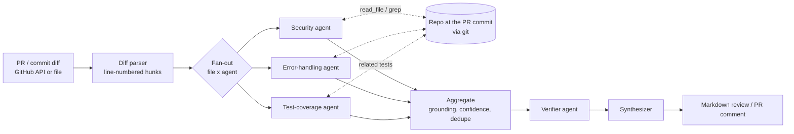

# Agentic Code Reviewer

A multi-agent reviewer for pull requests that checks **security**, **error handling** and **test coverage**. It runs entirely on a local model (Ollama, `qwen2.5-coder:7b`) and is evaluated by **backtesting against real, historical Django CVEs** from GitHub Security Advisories.

**Cost: $0.** No hosted LLM API, no paid service, no cloud resources. The only network calls are to GitHub's REST API (reading diffs and advisories, and optionally posting a PR comment).

> **Status (2026-10-15):** runs end to end on a laptop RTX 4070 (8 GB). It catches obvious planted bugs, but **0 of 40 real Django CVEs** after hand audit with the local 7B model. Measured numbers and why are in [Backtesting results](#backtesting-results). Anything marked _not run_ hasn't been measured yet; no numbers in this file are estimates.

## How it works



### How the data flows, step by step

1. **Get the diff.** `acr/cli.py` reads a unified diff from a file, or asks the GitHub API for a commit or PR diff (`acr/github_client.py`).
2. **Parse it** (`acr/diff_parser.py`). Each changed `.py` file becomes a `FileDiff`. Every line is printed with its real line number in the new file (`   15 +     query = f"..."`), because small models are bad at counting lines. Test files are marked so they can be used as context instead of being reviewed.
3. **Fan out** (`acr/graph.py`). LangGraph's `Send` creates one task per (file × specialist). With 3 files and 3 specialists that's 9 independent LLM calls. Each one sees one file and has one job.
4. **Specialists** (`acr/agents.py`). Each returns JSON matching a Pydantic schema: findings (line, severity, verbatim evidence, explanation, fix, confidence) plus optional `need_context` requests such as `read_file app/models.py` or `grep is_safe_url`. The graph runs those requests with read-only `git show` / `git grep` at the PR's commit (`acr/tools.py`) and asks again, for up to 2 rounds. The test-coverage agent always gets the related tests it needs, found deterministically by file name and new symbol names.
5. **Aggregate** (`acr/aggregate.py`, plain Python). *Grounding* drops any finding whose quoted evidence doesn't match a real added line, and snaps the line number to the matching line. Low-confidence findings are dropped. Duplicates (same file, nearby lines, same topic) are merged, keeping the higher severity and recording both agents.
6. **Verify.** A second "careful reviewer" prompt re-checks each surviving finding and rejects ones the code doesn't support. Coverage claims are checked against the same tests the specialist saw.
7. **Synthesize and render.** One last call writes a 2-4 sentence summary and a verdict; `acr/render.py` turns everything into Markdown. With `--post`, the comment is created or edited in place (re-runs don't spam the PR).

### Key decisions

**LangGraph over CrewAI/AutoGen.** The workflow is a fixed pipeline with one parallel map step, not an open-ended chat. LangGraph expresses that directly: typed state, an `operator.add` reducer so parallel agents append findings instead of overwriting each other, `Send` for the fan-out, and plain-Python nodes for the parts that must be deterministic. That explicit control flow is also what makes the ablations (single prompt vs multi-agent, verifier on/off) a one-env-var switch.

**Tool requests as a JSON field, not native function calling.** A 7B local model fills one JSON schema reliably; multi-turn tool calling is much flakier. So the agent *asks* for context in its JSON answer and the graph runs the tool.

**Code, not prompts, for anything checkable.** Grounding, confidence filtering, dedupe, the category label, severity caps and rendering are Python. The model only does the parts that need judgement.

**Reasoning before verdict.** In the verifier and judge schemas the `reason` field comes before the boolean. Models write JSON left to right; with the boolean first, the 7B model often committed to `is_real=false` and then wrote a reason saying the bug was real (seen in the first real run, fixed and covered by a test).

**Every schema field required.** Pydantic leaves fields that have defaults out of the JSON schema's `required` list, and Ollama's constrained decoding then accepts `{}`. The 7B model took that shortcut on almost every Django file. `SpecialistOutput` now requires `analysis`, `findings` and `need_context`, and `analysis` carries a `maxLength` in the schema so the grammar stops the model rambling. `ACR_NUM_PREDICT` caps every answer, so a looping generation fails fast instead of hanging a review for 10+ minutes.

**Snapshot backtesting, not "revert the fix".** Reviewing the reverse of a fix commit shows the protective code being deleted, which leaks the answer. The harness shows the reviewer the vulnerable *function(s)* as newly added code, then the same functions after the fix as a control.

## Setup (Windows, PowerShell)

Requirements: Python 3.11+, Git, [Ollama](https://ollama.com/download), and ideally an NVIDIA GPU with 8 GB VRAM (CPU works, just much slower).

```powershell
ollama pull qwen2.5-coder:7b          # ~4.7 GB, local and free
python -m venv .venv
.venv\Scripts\activate
pip install -r requirements-dev.txt   # or: pip install -r requirements.lock.txt for the exact tested versions
copy .env.example .env
```

On macOS/Linux use `source .venv/bin/activate` and `cp`.

### Credentials

| What | Needed for | How |
|---|---|---|
| nothing | reviewing a local diff file, the demo, running the backtest on an existing `data/cases.jsonl` | - |
| nothing (unauthenticated, 60 requests/hour) | `--commit` / `--pr` on public repos, building the dataset (Django's advisories fit in a couple of requests) | - |
| `GITHUB_TOKEN` in `.env` | more than 60 requests/hour, private repos, and `--post` | Fine-grained personal access token. Read-only "Public repositories" is enough for reading. For `--post`, add "Pull requests: Read and write" on **your own repo only**. |

`.env` is in `.gitignore`. Never commit it.

## Usage

```powershell
# 1. Demo: a tiny repo with a planted SQL injection, a swallowed exception and an untested function
python examples/build_demo.py
python -m acr.cli --diff-file examples/demo.diff --local-repo data/demo-repo -v --out review.md

# 2. Review a public commit (diff only, no repo tools)
python -m acr.cli --repo django/django --commit <sha>

# 3. Review your own PR with repo tools and post the comment (needs GITHUB_TOKEN with PR write)
python -m acr.cli --repo you/yourrepo --pr 3 --local-repo . --post
```

`-v` logs every agent's raw finding count and every finding dropped by grounding, confidence or the verifier, with the reason. Read it when the output looks wrong.

Configuration lives in `.env` (see `.env.example`):

| Variable | Default | Meaning |
|---|---|---|
| `ACR_MODEL` | `qwen2.5-coder:7b` | any Ollama model tag |
| `ACR_NUM_CTX` | `16384` | context window. Ollama **silently truncates** above it. Lower to 8192 if `ollama ps` shows less than 100% GPU |
| `ACR_MODE` | `multi` | `single` = one-prompt baseline (ablation) |
| `ACR_VERIFY` | `1` | `0` turns the verifier off (ablation) |
| `ACR_MIN_CONFIDENCE` | `0.5` | findings below this are dropped |
| `ACR_MAX_CONCURRENCY` | `1` | one GPU: parallel requests just queue in Ollama |
| `ACR_JUDGE_MODEL` | `qwen2.5-coder:7b` | model that grades the backtest |
| `ACR_NUM_PREDICT` | `2048` | max tokens per answer (stops runaway generations) |
| `ACR_SECURITY_PROMPT` | `v2` | `v1` = the original security prompt (reproduces the "before" rows) |

### Demo output (measured)

On `examples/demo.diff` (3 files, 9 specialist calls), `qwen2.5-coder:7b`, RTX 4070 Laptop 8 GB, `ollama ps` = 100% GPU at 16k context: **all three planted problems found** (SQL injection at `app/db.py:15`, `except Exception: pass` at `app/settings.py:12`, untested `find_user_by_email` / `apply_coupon` / `load_settings`). One false positive remains: a "path traversal" on `load_settings(path)`. It appeared once the security prompt started treating function arguments in library code as attacker-controlled (prompt v2): that rule helps on framework code and costs precision on app code. One review takes **~2 min** end to end.

## Testing

```powershell
ruff check .
ruff format --check .
pytest -q
```

`tests/test_core.py` covers the diff parser's line numbers, grounding, dedupe, snapshot diffs, and regression tests for every bug found in real runs (reasoning-before-verdict field order, the specialist schema refusing `{}`, coverage claims verified against the tests, the verifier's rejects kept for the backtest, the callers tool, the prompt-version switch, severity cap, `--post` validated before the slow review). The tests stub the model, so they run in under a second with no Ollama.

## Backtesting results

**Method.**
1. **Ground truth:** GitHub Security Advisories for the `django` pip package. Kept advisories whose fix commit exists in a full Django clone and touches 1-3 non-test `.py` files: **134 cases** (CWE mix led by SQL injection CWE-89 ×16, XSS CWE-79 ×16, resource exhaustion CWE-400 ×15 / CWE-770 ×12, input validation CWE-20 ×12, path traversal CWE-22 ×7). 25 were published after `qwen2.5-coder`'s release (2024-09-19).
2. **Reviewer input:** the enclosing function(s) of the lines the fix changed, at the parent commit, as newly added code. The reviewer never sees the advisory, commit message or fix. Its repo tools read Django at that same commit.
3. **Control:** the same functions at the fix commit.
4. **Scoring:** *strict hit* = the LLM judge says a finding has the same root cause **and** it's within ±5 lines of the changed lines. *Loose hit* = same root cause anywhere in the file. *False alarm* = the fixed version still gets flagged for the same issue.

5. **Split:** the 134 cases are split once (`eval/splits/django.json`). **Test** = 40 fixed cases, used only for measurement. **Dev** = the other 94, the only cases prompts were tuned on (`python -m eval.tune_security`).

**Results on the 40 test cases** (`qwen2.5-coder:7b`, RTX 4070 Laptop 8 GB, 100% GPU, judge = same 7B model). "Judge" columns are the automatic score; "audited" is after I hand-checked every judge match (see below).

| Configuration | Strict recall, judge (95% CI) | Strict recall, audited | False alarm on fixed code | Findings per clean snippet | Median latency per review |
|---|---|---|---|---|---|
| **Multi-agent + verifier** (current) | 1/40 = 2% (0-13%) | 0/40 | 4/40 = 10% (4-23%) | 1.52 | 55 s |
| Single prompt + verifier (current) | 0/40 = 0% (0-9%) | 0/40 | 3/40 = 8% (3-20%) | 0.90 | 28 s |
| Multi-agent + verifier, *before schema fix* | 0/40 = 0% (0-9%) | 0/40 | 0/40 | 1.98 | 47 s |
| Single prompt + verifier, *before schema fix* | 1/40 = 2% (0-13%) | 0/40 | 0/40 | 0.82 | 21 s |
| Multi-agent, verifier off | _not run_ | | | | |
| Multi-agent + verifier, `qwen2.5-coder:14b` | _tested, too slow on this hardware_ (see below) | | | | |
| Contamination subset (`--after 2024-09-19`) | _not run_ | | | | |

Reports: `results/2026-10-15-*.md`. Per-case JSON (every finding, every judge verdict with its reason, latencies) is in the timestamped run folders, which are git-ignored because they're large.

**What the numbers say.**
- **The 7B model doesn't catch real Django CVEs.** After auditing, 0/40 in every configuration. It does catch obvious planted bugs (see the demo).
- **"Before schema fix" rows:** the model answered `{}` on almost every Django file, because fields with defaults aren't "required" in the JSON schema and Ollama's constrained decoding allowed an empty object. Across 80 reviews that left 5 security findings. Making the fields required (plus prompt v2, tuned on dev) made it speak up, but it flags the **patched** code about as often as the vulnerable code: 4 false alarms vs 1 judged hit. Fixed code usually looks almost identical to vulnerable code (same string formatting, plus one escape call), and a 7B model can't tell the difference.
- **The verifier costs recall.** It rejected the one real catch the audit found: CVE-2019-14234 (SQL injection via the hstore/JSONField key name), flagged at the right line by the multi-agent *and* single-prompt runs and thrown away by the verifier both times. The backtest records this as "Strict catches the verifier rejected": 1/40 multi, 3/40 single (by judge).
- **Multi-agent vs single prompt:** multi-agent is 2x slower and noisier (mostly missing-test comments) for no measurable gain in catching CVEs on this model.

**Judge audit.** I read every finding the judge called a match on the vulnerable versions of the current runs (8 verdicts, including the verifier's rejects). I agreed with 4: CVE-2019-14234 ×3 (2 multi, 1 single) and CVE-2022-41323 (borderline). I disagreed with 4: CVE-2011-0696 (a generic "CSRF token not validated" comment, not the AJAX header bypass), CVE-2026-15307 (memory corruption, not the file-write/SSRF), and CVE-2024-39614 twice (both times the model just paraphrased the docstring "lru_cache should have a maxsize"). The judge rubric was tightened on dev cases mid-project (it had rejected a correct dev catch for not mentioning "control characters"). Every "current" row uses the new rubric; the "before schema fix" rows used the old one.

**14B trial** (`ACR_NUM_CTX=8192`, 1 test case, both versions): 656 s and 667 s per review, vs 131 s / 112 s for 7B on the same case. `ollama ps` showed a 43% CPU / 57% GPU split the whole time (the ~10 GB loaded model doesn't fit in 8 GB of VRAM). Free RAM dropped to 0.2 GB and the pagefile grew to 5.2 GB, so Windows was swapping. Projected full 40-case run: ~15 hours. I stopped after one case. On a GPU with 12-16 GB of VRAM it would be worth running.

**Caveats.** The judge is the same 7B model as the reviewer. Its matches were hand-audited (above), but its "no match" verdicts were only spot-checked, not systematically sampled. Small samples give wide confidence intervals; that's why the intervals are printed. Old Django CVEs are likely in the model's training data; use `--after 2024-09-19` for the contamination-controlled subset.

### Reproduce

```powershell
git clone https://github.com/django/django.git data/django    # FULL clone (~355 MB), not --filter=blob:none
python -m eval.build_dataset --repo django/django --package django --clone data/django --out data/cases.jsonl
python -m eval.backtest --cases data/cases.jsonl --clone data/django --split test
$env:ACR_MODE="single"; python -m eval.backtest --cases data/cases.jsonl --clone data/django --split test; Remove-Item Env:ACR_MODE
$env:ACR_VERIFY="0";    python -m eval.backtest --cases data/cases.jsonl --clone data/django --split test; Remove-Item Env:ACR_VERIFY
python -m eval.backtest --cases data/cases.jsonl --clone data/django --split test --resume results/<run-folder>   # continue an interrupted run
python -m eval.tune_security --n 20   # fast dev-only loop for prompt work; never use the test split for tuning
```

Each run writes per-case JSON plus `REPORT.md` under `results/<timestamp>-<mode>-snapshot/`.

## GitHub Action (self-hosted, not yet verified)

`.github/workflows/review.yml` runs the reviewer on a **self-hosted runner** (your own machine with Ollama), so no hosted LLM and no paid CI minutes are involved. It only runs for PRs from branches in the same repo, never from forks, because a fork PR would execute untrusted code on your machine. Setup: repo **Settings → Actions → Runners → New self-hosted runner**, keep `ollama serve` running, and make sure `python` and `git` are on the runner's PATH. **Not tested yet**, and neither is `--post` against a real PR.

## Troubleshooting

| Symptom | Fix |
|---|---|
| Very slow reviews, `ollama ps` shows e.g. `40%/60% CPU/GPU` | Other apps are using VRAM (browsers, Discord, overlays). Close them or set `ACR_NUM_CTX=8192`. |
| `UnicodeEncodeError` printing the review | Fixed: the CLI and backtest force UTF-8 stdout. If you pipe elsewhere, use `--out review.md`. |
| `ModuleNotFoundError: No module named 'acr'` in pytest | Run `pytest` from the repo root (`pyproject.toml` sets `pythonpath = ["."]`). |
| Many findings "dropped ungrounded" in `-v` | The model paraphrased instead of copying the line. Try a bigger model or a smaller diff. |
| Every finding rejected by the verifier | Run with `-v` to read the verifier's reasons, and compare with `ACR_VERIFY=0`. |
| `403` / rate limit from GitHub | Unauthenticated limit is 60/hour. Add `GITHUB_TOKEN` to `.env`. |
| Backtest grep/read very slow | You cloned with `--filter=blob:none`; use a full clone. |

## Project layout

```
acr/            reviewer: diff_parser, agents (prompts), tools (git read/grep), aggregate, graph, render, cli
eval/           build_dataset (advisories -> cases), snapshot (case -> diff), judge, backtest (metrics + Wilson CIs),
                tune_security (dev-only loop), splits/django.json (frozen dev/test split)
examples/       build_demo.py + demo.diff (planted bugs), trial_14b.sh (2-case speed/RAM trial for bigger models)
tests/          unit + regression tests (model stubbed)
docs/           implementation-guide.md: the full design write-up
results/        backtest reports
```

See [`docs/implementation-guide.md`](docs/implementation-guide.md) for the full design discussion. Note that the guide also describes optional free-tier hosted API fallbacks; this repo doesn't use them (everything runs locally).
