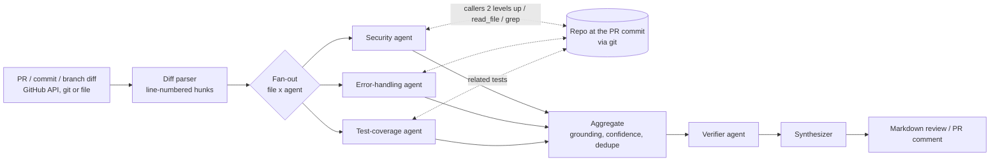
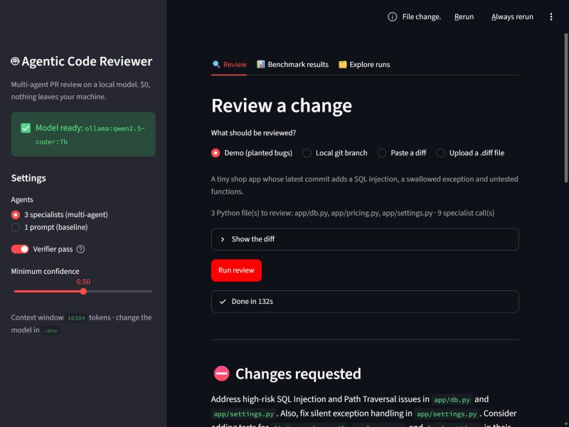
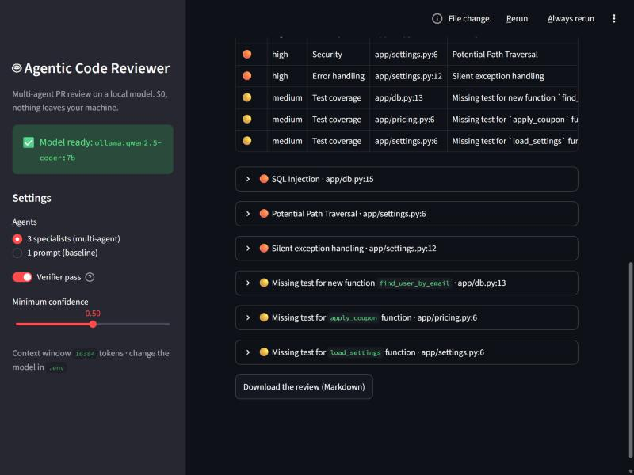

# Agentic Code Reviewer

A multi-agent reviewer for pull requests that checks **security**, **error handling** and **test coverage**. It runs entirely on a local model (Ollama, `qwen2.5-coder:7b`) and is evaluated by **backtesting against real, historical CVEs** from GitHub Security Advisories, with a frozen test set, a patched-code control, confidence intervals and human labels.

**Cost: $0.** No hosted LLM API, no paid service, no cloud resources. The only network calls go to GitHub's REST API (reading diffs and advisories, and optionally posting a PR comment).

> **Honest summary (2026-10-16).** The reviewer runs end to end on a laptop RTX 4070 (8 GB) and catches obvious planted bugs. On **real** vulnerabilities, a local 7B model catches **1-3 of 40 Django CVEs** depending on the configuration, and about as often flags the already-patched code. On application-level CVEs (pyload, Flask-AppBuilder) it catches **4 of 39** (10%) with only 2 false alarms, including 3 of the 21 published after the model's release. Shown the fix being removed (a leaky upper bound) it catches 11/40 Django CVEs, so the model's unaided judgement is the bottleneck, not the pipeline. Every number below was measured; nothing is estimated.


## How it works



### How the data flows, step by step

1. **Get the diff.** `acr/cli.py` reads a unified diff from a file, runs `git diff base...branch` on a local repo, or asks the GitHub API for a commit or PR diff (`acr/github_client.py`). Before anything slow, it checks that Ollama is running and the model is pulled.
2. **Parse it** (`acr/diff_parser.py`). Each changed `.py` file becomes a `FileDiff`. Every line is printed with its real line number in the new file (`   15 +     query = f"..."`), because small models are bad at counting lines. Test files are marked so they're used as context, not reviewed.
3. **Fan out** (`acr/graph.py`). LangGraph's `Send` creates one task per (file × specialist). With 3 files and 3 specialists that's 9 independent LLM calls, each seeing one file with one job.
4. **Specialists** (`acr/agents.py`). Each answers in JSON matching a Pydantic schema: a short `analysis` first, then findings (line, severity, verbatim evidence, explanation, fix, confidence), plus optional `need_context` requests (`read_file`, `grep`) that the graph runs with read-only `git show` / `git grep` at the PR's commit (`acr/tools.py`), for up to 2 rounds. Deterministic context is added without asking the model: the security agent gets the **callers of each changed function, two levels up** (for example `get_supported_language_variant ← get_language_from_path ← LocaleMiddleware.process_request(request.path_info)`), and the test-coverage agent gets the related tests.
5. **Aggregate** (`acr/aggregate.py`, plain Python). *Grounding* drops any finding whose quoted evidence isn't a real added line, and snaps line numbers to the matching line. Low-confidence findings are dropped. Duplicates (same file, nearby lines, same topic) are merged.
6. **Verify.** A second, skeptical prompt re-checks each finding. Coverage claims are checked against the same tests the specialist saw.
7. **Synthesize and render.** One last call writes a short summary and a verdict; `acr/render.py` turns everything into Markdown. If any agent call failed, the review says "⚠️ incomplete" and never approves. With `--post`, the PR comment is created or edited in place.

### Key decisions (and what the measurements said about them)

**LangGraph over CrewAI/AutoGen.** The workflow is a fixed pipeline with one parallel map step, not an open-ended chat. LangGraph expresses that directly: typed state, an `operator.add` reducer so parallel agents append findings, `Send` for the fan-out, plain-Python nodes for anything deterministic. That explicit control flow is what makes every ablation a one-env-var switch.

**Tool requests as a JSON field, not native function calling.** A 7B local model fills one JSON schema reliably; multi-turn tool calling is much flakier.

**Code, not prompts, for anything checkable.** Grounding, confidence filtering, dedupe, the category label, severity caps, caller tracing and rendering are Python. Grounding dropped very few findings, so the model quotes code accurately.

**Every schema field required, reasoning first.** This was the most important bug found. Pydantic leaves fields with defaults out of the JSON schema's `required` list, and Ollama's constrained decoding then accepts a bare `{}`. The 7B model took that shortcut on almost every Django file (5 security findings in 80 reviews). The same lesson made every schema put its reasoning field *before* its verdict: with the boolean first, the model committed to `is_real=false` and then wrote a reason saying the bug was real. `analysis` also carries a schema-level `maxLength`, and `ACR_NUM_PREDICT` caps every answer, so a looping generation fails fast instead of hanging a review.

**The verifier trades recall for precision almost 1:1.** It is on by default because it keeps reviews readable (about 1.5 findings per clean snippet instead of 4). On the Django test set it also threw away 1-2 of the 2-3 real catches. Pick `ACR_VERIFY=0` if you prefer recall.

**Multi-agent vs one prompt.** With this model, three specialists cost 2x the time of one prompt and caught more only with the verifier off. The architecture is there for stronger models, and the ablation switch shows exactly what it buys.

**Snapshot backtesting, not "revert the fix".** Reviewing the reverse of a fix commit shows the protective code being deleted, which leaks the answer (and measurably inflates recall, see below). The harness shows the vulnerable *function(s)* as newly added code, then the same functions after the fix as a control.

## Setup (Windows, PowerShell)

Requirements: Python 3.11+, Git, [Ollama](https://ollama.com/download), and ideally an NVIDIA GPU with 8 GB VRAM (CPU works, much slower).

```powershell
ollama pull qwen2.5-coder:7b          # ~4.7 GB, local and free
python -m venv .venv
.venv\Scripts\activate
pip install -r requirements-dev.txt   # or requirements.lock.txt for the exact tested versions
copy .env.example .env
```

On macOS/Linux use `source .venv/bin/activate` and `cp`.

### Credentials

| What | Needed for | How |
|---|---|---|
| nothing | local diffs, local branches (`--base`), the demo, backtests on existing case files | - |
| nothing (unauthenticated, 60 requests/hour) | `--commit` / `--pr` on public repos, building datasets (a few requests per package) | - |
| `GITHUB_TOKEN` in `.env` | more than 60 requests/hour, private repos, and `--post` | Fine-grained personal access token. Read-only "Public repositories" for reading; add "Pull requests: Read and write" on **your own repo only** for `--post`. |

`.env` is in `.gitignore`. Never commit it.

## Web UI

```powershell
streamlit run ui/app.py      # opens http://127.0.0.1:8501
```

- **Review:** pick the demo, a local git branch, a pasted diff or an uploaded `.diff`, then watch live progress ("Specialist calls: 6/9"). Results come as a verdict, the funnel (raw → grounded → deduped → verified), filterable findings with evidence, explanation and fix, the findings the verifier threw away, and a Markdown download.
- **Benchmark results:** the measured backtest numbers, the chart and every report.
- **Explore runs:** any backtest run, case by case, with every finding, judge verdict and human label.

The sidebar checks that Ollama and the model are ready, and switches between multi-agent and single prompt, verifier on and off, and the confidence threshold. `.streamlit/config.toml` binds the server to `127.0.0.1` (the UI can read any local repo you point it at, so it must not be reachable from your network) and hides Streamlit's "Deploy" button.




## Usage (CLI)

```powershell
# Demo: a tiny repo with a planted SQL injection, a swallowed exception and untested functions
python examples/build_demo.py
python -m acr.cli --diff-file examples/demo.diff --local-repo data/demo-repo -v --out review.md

# Review a local branch against its base, no GitHub needed
python -m acr.cli --local-repo path\to\repo --base main --ref my-feature

# Review a public commit (diff only)
python -m acr.cli --repo django/django --commit <sha>

# Review your own PR with repo tools and post the comment (needs GITHUB_TOKEN with PR write)
python -m acr.cli --repo you/yourrepo --pr 3 --local-repo . --post
```

`-v` logs each agent's raw finding count and every finding dropped by grounding, confidence or the verifier, with the reason. The CLI exits with code 2 if Ollama or the model is missing, and 1 if some agent calls failed (the review is then marked incomplete).

Configuration lives in `.env` (see `.env.example`):

| Variable | Default | Meaning |
|---|---|---|
| `ACR_MODEL` | `qwen2.5-coder:7b` | any Ollama model tag |
| `ACR_NUM_CTX` | `16384` | context window. Ollama **silently truncates** beyond it. Lower to 8192 if `ollama ps` shows less than 100% GPU |
| `ACR_NUM_PREDICT` | `2048` | max tokens per answer (stops runaway generations) |
| `ACR_MODE` | `multi` | `single` = one-prompt baseline |
| `ACR_VERIFY` | `1` | `0` turns the verifier off: more recall, much more noise |
| `ACR_MIN_CONFIDENCE` | `0.5` | findings below this are dropped |
| `ACR_MAX_CONCURRENCY` | `1` | one GPU: parallel requests just queue in Ollama |
| `ACR_SECURITY_PROMPT` | `v2` | `v1` = the original security prompt |
| `ACR_JUDGE_MODEL` | `qwen2.5-coder:7b` | model that grades backtests (humans re-label afterwards, see below) |

### Demo output (measured)

`python examples/build_demo.py` creates a two-commit repo; `python -m acr.cli --local-repo data/demo-repo --base HEAD~1 --ref HEAD` reviews it (3 files, 9 specialist calls, `qwen2.5-coder:7b`, RTX 4070 Laptop at 100% GPU, **~2 min**). It finds **all three planted problems**: the SQL injection at `app/db.py:15`, `except Exception: pass` at `app/settings.py:12`, and the untested `find_user_by_email` / `apply_coupon` / `load_settings`. One false positive remains: a "path traversal" on `load_settings(path)`, the price of the security prompt treating function arguments as attacker-controlled (which framework code needs).

## Testing

```powershell
ruff check .
ruff format --check .
pyright                    # type check (same engine as VS Code's Pylance)
pytest -q
```

`tests/test_core.py` (23 tests) covers the Streamlit app (run headless with `streamlit.testing`), plus the diff parser, grounding, dedupe and snapshot diffs; a full LangGraph run end to end; the incomplete-review path when agent calls fail; the Ollama preflight; local-branch diffs; PR-comment pagination; caller tracing; the human-label scorer; and a regression test for every bug found in real runs (the `{}` schema shortcut, reasoning-before-verdict order, coverage claims verified against the tests, `--post` validated before the slow review). The model and GitHub are stubbed (clearly, in the test code), so the suite runs in a few seconds with no Ollama and no network. That proves the plumbing, not the model's quality: quality is what the backtests measure.

## Backtesting results

### Method

1. **Ground truth:** GitHub Security Advisories with a fix commit that exists in a full clone of the repo and touches 1-3 non-test `.py` files.
   - **Django:** 134 cases, split once into **dev = 94** (the only cases prompts were tuned on) and **test = 40** (only ever measured), saved in `eval/splits/django.json`.
   - **Apps:** 39 cases from **pyload** (30) and **Flask-AppBuilder** (9): application code with path traversal, auth bypass, open redirect and command-injection bugs. Never used for tuning.
2. **Reviewer input:** the enclosing function(s) of the lines the fix changed, at the parent commit, presented as newly added code. The reviewer never sees the advisory, commit message or fix. Its repo tools read the repository at that same commit.
3. **Control:** the same functions at the fix commit. A reviewer that flags the patched code for the same bug is guessing.
4. **Scoring:** an LLM judge (same 7B model) proposes "same root cause?", then **every judged finding is labelled by hand** (`eval/labels/*.csv`, one note per "yes"). *Caught* = a human-confirmed finding within ±5 lines of the changed lines. *False alarm* = a human-confirmed claim of the same bug on the patched version. The judge alone was unreliable: across the Django and app runs it agreed with the labels on 97-98% of findings, but on the few that matter it called 11 findings matches of which only 6 were right in one run, and missed 7 of 16 real catches in another. Labels were reviewed twice; borderline calls are marked `BORDERLINE` in the note column, and the stricter reading was used for Django (CVE-2025-32873's "infinite loop" claim was relabelled "no" on the second pass).
5. **Statistics:** 95% Wilson confidence intervals. With 40 cases, differences of 1-2 cases are noise.

### Results

`qwen2.5-coder:7b`, RTX 4070 Laptop 8 GB at 100% GPU, multi-agent unless noted. Human-labelled.

| Benchmark · configuration | Caught (95% CI) | False alarms on patched code | Findings per clean snippet | Median latency per review |
|---|---|---|---|---|
| **Django 40 · final config** (prompt v2, callers 2 levels, verifier on) | 1/40 = 2% (0-13%) | 2/40 | 1.50 | 55 s |
| Django 40 · final config, verifier off | 2/40 = 5% (1-17%) | 8/40 | 4.05 | - |
| Django 40 · prompt v2, callers 1 level, verifier on | 2/40 = 5% (1-17%) | 2/40 | 1.52 | 55 s |
| Django 40 · prompt v2, callers 1 level, verifier off | 3/40 = 8% (3-20%) | 5/40 | 4.03 | 39 s |
| Django 40 · single prompt, verifier on | 0/40 = 0% (0-9%) | 3/40 | 0.90 | 28 s |
| Django 40 · before the schema fix (multi / single) | 0/40 (judge-audited only) | 0/40 | 1.98 / 0.82 | 47 s / 21 s |
| Django 40 · **reverse mode, leaky upper bound** (sees the fix being removed) | 11/40 = 28% (16-43%) | n/a | - | 36 s |
| **Apps 39 · final config** | **4/39 = 10% (4-24%)** | 2/39 | 2.51 | 63 s |
| Apps 39 · final config, verifier off | 5/39 = 13% (6-27%) | 5/39 | 4.54 | - |
| Django 40 · `qwen2.5-coder:14b` | _tested, too slow on this hardware_ (see below) | | | |

"Verifier off" rows for the final config come from the same run: the specialists are deterministic (temperature 0) and the verifier's rejects are judged and stored, so `python -m eval.audit score <run> --ignore-verifier` gives the verifier-off result. I checked this against a separate `ACR_VERIFY=0` run: identical.

Reports: `results/*.md`. Per-case JSON (every finding, every judge verdict, latencies) lives in the timestamped run folders, which are git-ignored because they're large.

### What the numbers say

- **A local 7B model is not a security reviewer for framework code.** 1-3 of 40 real Django CVEs, depending on settings, and it flags the patched code about as often. The catch that shows up in every run (sometimes thrown away by the verifier) is CVE-2019-14234, SQL injection through the JSONField/HStoreField key name.
- **The pipeline isn't the bottleneck.** When the diff shows the fix being removed, the same pipeline catches 11/40. What's missing is the model noticing the bug without a hint.
- **Application code is where it starts to work.** On pyload and Flask-AppBuilder it caught 4/39 with the verifier on, and **all 4 were clean catches** (the patched version was not flagged): SQL injection built from URLs (CVE-2025-55156), path traversal via a package name (CVE-2025-54802), a bypassable storage-folder check (CVE-2024-47821) and database errors shown to users (CVE-2023-34110, borderline: right spot, but the model calls it logging). 3 of those 4 were published after the model's release, so this isn't memorisation. App bugs are local: the dangerous value and the sink sit in the same function, which suits a one-file reviewer.
- **Tuning on dev didn't transfer.** Two-level caller tracing raised dev recall from 1/20 to 2/20, and on the test set it moved recall from 2/40 to 1/40 (verifier on). That's all within noise, and I didn't re-tune on the test set.
- **The verifier removes signal and noise about equally;** the single prompt is 2x faster and quieter and catches nothing more.

### 14B trial

`ACR_NUM_CTX=8192`, 1 test case: 656 s and 667 s per review vs 131 s / 112 s for 7B. `ollama ps` showed a 43% CPU / 57% GPU split (the ~10 GB loaded model doesn't fit in 8 GB of VRAM). Free RAM fell to 0.2 GB and the pagefile grew to 5.2 GB, so Windows was swapping. A full run would take ~15 hours, so I stopped after one case (log: `results/trial14b.log`). With 12-16 GB of VRAM it's worth running: `examples/trial_14b.sh` measures speed and memory first.

### Reproduce

```powershell
git clone https://github.com/django/django.git data/django    # FULL clone (~355 MB), not --filter=blob:none
python -m eval.build_dataset --repo django/django --package django --clone data/django --out data/cases.jsonl
python -m eval.backtest --cases data/cases.jsonl --clone data/django --split test

git clone https://github.com/pyload/pyload.git data/pyload
git clone https://github.com/dpgaspar/Flask-AppBuilder.git data/flask-appbuilder
python -m eval.build_dataset --repo pyload/pyload --package pyload-ng --clone data/pyload --out data/cases_pyload.jsonl
python -m eval.build_dataset --repo dpgaspar/Flask-AppBuilder --package flask-appbuilder --clone data/flask-appbuilder --out data/cases_fab.jsonl
Get-Content data/cases_pyload.jsonl, data/cases_fab.jsonl | Set-Content data/cases_apps.jsonl
python -m eval.backtest --cases data/cases_apps.jsonl --clone data/pyload --n 100

# Human labelling and scoring
python -m eval.audit export results/<run>                       # writes results/<run>/audit.csv, prefilled from earlier labels
python -m eval.audit score  results/<run> --labels eval/labels/django_test.csv [--ignore-verifier]

# Variants
$env:ACR_MODE="single"; python -m eval.backtest ... ; Remove-Item Env:ACR_MODE
python -m eval.backtest ... --mode reverse                      # leaky upper bound
python -m eval.backtest ... --resume results/<run>              # continue an interrupted run
python -m eval.tune_security --n 20                             # dev-only prompt loop; never tune on the test split
python -m eval.plot_results                                     # results/summary.json -> docs/results.svg
```

## On real GitHub pull requests (verified)

`python examples/build_demo_prs.py` builds a small Flask shop with four PR branches containing planted bugs, plus one clean refactor as a control. I pushed it to a private GitHub repo, opened the four PRs, and ran
`python -m acr.cli --repo <you>/acr-demo-shop --pr <n> --local-repo ../acr-demo-shop --ref <branch> --post` on each (diff fetched from the GitHub API, review posted as a PR comment, 35-133 s per PR):

| PR | Planted | Review comment |
|---|---|---|
| #1 order search | SQL injection, open redirect after login | ✅ SQL injection (high) · ❌ missed the open redirect |
| #2 invoice download | path traversal, `except Exception: pass` | ✅ both |
| #3 thumbnails | command injection (`shell=True`), untested helper | ✅ both, plus a fair path-traversal note on the upload name |
| #4 pricing refactor | nothing (clean, with tests) | ✅ "Looks good" |

6 of 7 planted bugs caught, and the clean PR approved. Re-running `--post` edits the existing comment instead of adding a new one (checked on PR #4). This demo also exposed a duplicate: the error-handling agent called `shell=True` a security risk on the same line as the security agent's finding. Dedupe now merges that case.

## GitHub Action (self-hosted, not yet verified)

`.github/workflows/review.yml` runs the reviewer on a **self-hosted runner** (your own machine with Ollama), so no hosted LLM and no paid CI minutes are involved. It only runs for PRs from branches in the same repo, never from forks, because a fork PR would execute untrusted code on your machine. Setup: repo **Settings → Actions → Runners → New self-hosted runner**, keep Ollama running, and make sure `python` and `git` are on the runner's PATH. The workflow itself is **not tested yet** (it needs a self-hosted runner registered on your repo); the `--post` step it runs is verified above.

## Troubleshooting

| Symptom | Fix |
|---|---|
| `error: Ollama is not reachable` | Start the Ollama app (or `ollama serve`). Check `ACR_OLLAMA_URL`. |
| `error: Model ... is not pulled` | `ollama pull qwen2.5-coder:7b` (or whatever `ACR_MODEL` says). |
| Review says "⚠️ Review incomplete" | Some agent calls failed. Run with `-v` to see which and why. |
| Very slow reviews, `ollama ps` shows e.g. `40%/60% CPU/GPU` | Other apps are using VRAM (browsers, Discord, overlays). Close them or set `ACR_NUM_CTX=8192`. |
| `UnicodeEncodeError` printing the review | The CLI forces UTF-8 output; if you pipe elsewhere, use `--out review.md`. |
| `ModuleNotFoundError: No module named 'acr'` in pytest | Run `pytest` from the repo root. |
| Many findings "dropped ungrounded" in `-v` | The model paraphrased instead of copying the line. Try a bigger model or a smaller diff. |
| `403` / rate limit from GitHub | The unauthenticated limit is 60/hour. Add `GITHUB_TOKEN` to `.env`. |
| Backtest grep/read very slow | You cloned with `--filter=blob:none`; use a full clone. |

## Project layout

```
acr/            reviewer: diff_parser, agents (prompts), tools (git read/grep/callers), aggregate, graph, render, config, cli
ui/            Streamlit web UI (app.py); .streamlit/config.toml keeps it on localhost
eval/           build_dataset, snapshot, judge, backtest (Wilson CIs, --split/--resume/--mode),
                audit (human labels), tune_security (dev-only loop), plot_results, splits/, labels/
examples/       build_demo.py + demo.diff (planted bugs), trial_14b.sh (speed/RAM trial for bigger models)
tests/          unit, regression and integration tests (model and GitHub stubbed)
docs/           implementation-guide.md (the full design write-up), results.svg, UI screenshots
results/        backtest reports and summary.json
```

See [`docs/implementation-guide.md`](docs/implementation-guide.md) for the original design discussion. It also describes optional free-tier hosted API fallbacks; this project doesn't use them (everything runs locally).

## License

MIT, see [LICENSE](LICENSE).
