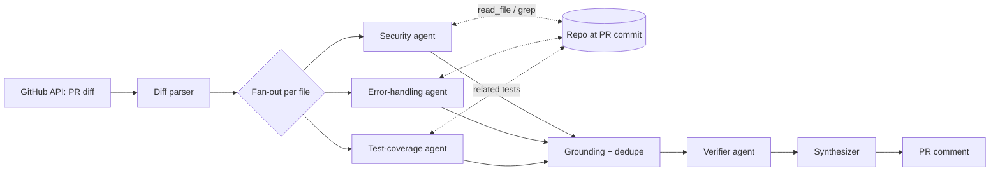

# Agentic Code Reviewer

A multi-agent reviewer for GitHub pull requests that checks **security**, **error handling** and **test coverage**, runs entirely on free, local models, and is evaluated by **backtesting against real historical CVEs** in Django.

> **Result:** caught **X/N (Y%)** of real Django vulnerabilities in a leakage-controlled backtest (95% CI A-B%), and stayed quiet on the patched code in **Z%** of cases. Full numbers below.


## How it works



- Each specialist reviews one file for one concern, in parallel (LangGraph `Send`).
- Agents can request more context (read a file, grep the repo) for up to two rounds.
- Every finding must quote an added line verbatim; ungrounded findings are dropped in code, not by another prompt.
- A skeptical verifier agent re-checks findings; the synthesizer writes the summary and verdict.

**Stack:** Python · LangGraph · Ollama (`qwen2.5-coder:7b`) · GitHub REST API · GitHub Actions. Inference cost: $0.

## Backtesting results

**Method.** Ground truth = GitHub Security Advisories for `django` with a linked fix commit touching 1-3 source files (N cases). For each, the reviewer sees the vulnerable function(s) at the parent commit as newly added code, with no advisory text, commit message or fix. As a control it also reviews the same functions after the fix. A hit requires the same root cause (LLM judge, hand-audited, agreement Q%) within ±5 lines of the changed code.

| Configuration | Strict recall (95% CI) | False alarm on fixed code | Findings per clean snippet | Median latency |
|---|---|---|---|---|
| Single prompt, 7B | | | | |
| Multi-agent, 7B, no verifier | | | | |
| **Multi-agent, 7B, verifier** | | | | |
| Multi-agent, 14B, verifier | | | | |

Recall on advisories published after the model's release: **X/M**. (Older CVEs may be in the training data.)

Per-CWE breakdown and every case's raw output: [`results/`](results/).

**What it misses:** _(be specific, e.g. multi-file logic bugs, issues needing settings context)_

## Decisions

**Why LangGraph (over CrewAI and AutoGen).** The workflow is a fixed pipeline with one parallel map step, not an open-ended conversation. LangGraph let me express that as an explicit graph: typed state, a reducer for parallel results, and `Send` for the file × agent fan-out, with plain-Python nodes for the parts that must be deterministic. CrewAI's role/task abstraction and AutoGen's chat-between-agents model hide the control flow I needed to measure and ablate.

**Why tool requests in JSON instead of native function calling.** 7B local models filled a single JSON schema reliably but were unreliable at multi-turn tool calling, so agents return `need_context` requests that the graph executes.

**Hallucinations and duplicates.**
1. Line-numbered diffs so the model doesn't count lines.
2. Grounding: the quoted evidence must match an added line, or the finding is dropped (dropped D% of raw findings).
3. Confidence threshold, then dedupe by file, line proximity and topic overlap (merged M% of findings, mostly security/error-handling overlap on input validation).
4. Verifier agent (measured effect in the table above).

**Why snapshot backtesting instead of reverting the fix.** Reviewing the revert diff shows the protective code being deleted, which leaks the answer. That variant scored R% vs S% for snapshots; only the snapshot number is reported as the result.

## Run it

```bash
ollama pull qwen2.5-coder:7b
pip install -r requirements.txt && cp .env.example .env
python -m acr.cli --repo django/django --commit <sha>
python -m eval.backtest --cases data/cases.jsonl --clone data/django --n 40
```
