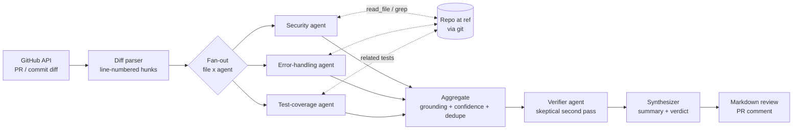
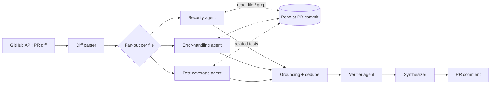

# Agentic Code Reviewer: Honest Review + $0 Implementation Guide

*Written 2026-10-14 for Abdul. All code below is also in the [`starter/`](starter/) folder next to this file, ready to copy into a repo.*

**What was verified:** the unit tests pass, the full LangGraph pipeline ran end to end with a stubbed model (fan-out, tool requests, grounding, dedupe, verifier, Markdown output), and the backtest diff builder ran on real Django CVE fix commits (CVE-2024-39329, CVE-2024-39330, CVE-2024-39614). **Not verified:** a run with a real Ollama model (the build machine couldn't download Ollama), and the GitHub advisories download (blocked there too). Expect to tune prompts once you see real outputs.

---

## Part 0. Is this a good project?

**Short answer: yes, it's one of the better portfolio projects you can pick, but only because of the evaluation.** An "AI that reviews PRs" on its own is not impressive in 2026. CodeRabbit, GitHub Copilot review, Qodo PR-Agent and dozens of open-source bots already do it, and recruiters have seen many LangGraph wrappers. What almost nobody does is **measure** whether their reviewer works. A clean, honest backtest with recall, false-alarm rate, confidence intervals and an ablation is what makes this stand out, and it's also what you'll talk about in interviews.

It's also a good fit for $0: local 7B-14B coding models are good enough to get real, non-trivial numbers, and everything else (GitHub API, Actions on public repos, LangGraph) is free.

### What the guideline gets wrong or glosses over

1. **"Revert the fix and review the buggy code" leaks the answer.** If you feed the reviewer the reverse of the fix commit, the `-` lines literally show the protective check being deleted ("- if not is_safe_path(name):"). That's a giant hint, so your recall will look great and mean little. **Fix:** review a *snapshot* of the vulnerable function(s) presented as newly added code, so the reviewer sees buggy code with no clue about what changed. The guide implements both and tells you to report the snapshot number as the headline.
2. **Recall alone is a meaningless metric.** A reviewer that flags every line as SQL injection gets 100% recall. You need a false-positive measure. **Fix:** run the reviewer on the *fixed* version of the same functions too. A real catch is "flags the vulnerable version AND stays quiet on the fixed version". This paired control is cheap and much more convincing than any number in the guideline.
3. **20 cases is too few to claim "75%".** With 15/20, the 95% confidence interval is roughly **53% to 89%**. Use 40 or more cases and print the interval. Interviewers who know stats will respect it.
4. **Data contamination.** Django's old CVEs and their fixes are almost certainly in every model's training data. **Fix:** report recall separately for advisories published *after* your model's release date (the harness has an `--after` flag).
5. **"Use the GitHub API to checkout the parent commit"** isn't possible. The API serves files and diffs; checking out happens in a local `git clone`. The harness reads old code with `git show <sha>^:path`, so no checkout is needed. Use a full clone, not `--filter=blob:none`, or repo-wide grep at old commits becomes painfully slow.
6. **"Compare findings against the bug description"** needs a defined rule. The harness uses: right file, within ±5 lines of the lines the fix changed, and an LLM judge agreeing it's the same root cause. Then you hand-audit every judge "yes" and a sample of "no"s and report the agreement rate.
7. **Finding bugs by grepping commit messages for "fix bug"** gives noisy, ungraded data. **Better:** GitHub Security Advisories (free API) list CVE, CWE, a description *and* the fix commit URL. That's real ground truth.
8. **The Error Handling agent as described ("missing try/catch") will drown you in noise.** Wrapping Python in try/except "just in case" is bad practice. The prompt below only flags specific, realistic mishandled failures.
9. **The Test Coverage agent can't work from the diff alone.** It needs to see the repo's existing tests. This is where the "tool use" part becomes genuinely necessary rather than decorative.
10. **The example "Decision File" sentence is invented.** "LangGraph allows cyclical communication so the Synthesizer can ask follow-up questions" describes a feature you wouldn't have built. Don't put claims in your README that your code doesn't do; interviewers ask. The template in Part 4 gives reasons that match this code.
11. **"Reduced false positives by X%"** needs a baseline to compare against. The harness supports a single-prompt baseline and a verifier on/off switch so you can actually measure it.
12. **"Most advanced project"** is hype. It's very doable in 3-5 weekends.

---

## Part 1. Architecture & setup

### 1.1 Architecture



Design choices that matter (each one is a talking point):

- **Map-reduce over (file × agent).** LangGraph's `Send` runs each specialist on each file in parallel, and a list reducer collects findings. Small models do much better on one file and one concern than on a whole PR.
- **Line-numbered diff.** Every line is printed with its real new-file line number. Small models can't count lines; this one trick fixes most "wrong line" findings.
- **Deterministic code wherever possible.** Grounding (the quoted evidence must exist on an added line), confidence filtering, dedupe and Markdown rendering are plain Python. The LLM only does what needs judgement. This is the main defence against hallucination.
- **Tool use via a JSON field instead of native function calling.** Each agent can return `need_context: [{tool: read_file|grep, arg}]`; the graph runs those tools and re-asks, up to 2 rounds. 7B-14B local models fill one JSON schema reliably but are flaky at multi-turn function calling.
- **Verifier pass.** A separate "skeptical reviewer" prompt re-checks each finding. You measure whether it pays for itself (ablation).

### 1.2 Hardware for the local route

Ollama runs quantized (Q4) models. Rough needs:

| Model (Ollama tag) | Download | Runs well on | Notes |
|---|---|---|---|
| `qwen2.5-coder:3b` | ~2 GB | any laptop, 8 GB RAM, CPU ok | Fine for CI smoke tests, weak reviewer |
| **`qwen2.5-coder:7b`** (default) | ~4.7 GB | GPU with 8 GB VRAM, or 16 GB RAM on CPU (slow) | Best $0 starting point |
| `qwen2.5-coder:14b` | ~9 GB | GPU with 12-16 GB VRAM | Noticeably better at security reasoning |
| `qwen3-coder:30b` (MoE) | ~19 GB | 24 GB VRAM, or 32 GB+ RAM (MoE is usable on CPU) | Strongest local option if you have the memory |

Check [ollama.com/library](https://ollama.com/library) for newer coder models before you start; swapping is one env var. CPU-only works but expect minutes per review rather than seconds, which matters for a 40-case backtest x 2 versions x 3 agents. Rough budget: at 7B on an 8 GB GPU, a full 40-case backtest is an evening; on CPU, a weekend.

Ollama has a native Windows installer, so you can do all of this on Windows (PowerShell) or in WSL.

> **The #1 local gotcha:** Ollama's default context window is small and it **silently truncates** long prompts. The code sets `num_ctx=16384`. Each extra 8k of context costs VRAM, so drop to 8192 if you run out.

### 1.3 Free API fallback

If your machine is too weak, or for GitHub Actions, use a free tier through the same code (just env vars):

- **Google Gemini API free tier** (`ACR_PROVIDER=google_genai`, e.g. `gemini-2.5-flash`, key from Google AI Studio). Generous for this use. **Caveat:** on the free tier Google may use your prompts to improve its products, so only send public/open-source code.
- **Groq free tier** (`ACR_PROVIDER=groq`, e.g. `llama-3.3-70b-versatile`). Very fast, tighter daily limits.
- **OpenRouter `:free` models** also work through an OpenAI-compatible client if you add `langchain-openai`.

Free-tier model names and rate limits change often; check the provider's page. Keep `ACR_MAX_CONCURRENCY=1` on free tiers to avoid rate-limit errors. The fallback is wired so a failed local call automatically retries on the API.

### 1.4 Install

```bash
# 1. Ollama: install from https://ollama.com/download (Windows/macOS/Linux), then:
ollama pull qwen2.5-coder:7b
ollama run qwen2.5-coder:7b "say hi"      # sanity check

# 2. Project
git clone <your-new-repo> agentic-code-reviewer && cd agentic-code-reviewer
python -m venv .venv
source .venv/bin/activate                 # Windows: .venv\Scripts\activate
pip install -r requirements.txt
cp .env.example .env                      # Windows: copy .env.example .env

# 3. GitHub token (free): github.com > Settings > Developer settings > Fine-grained tokens,
#    "Public repositories (read-only)". Paste into .env as GITHUB_TOKEN. Raises your limit from 60 to 5,000 requests/hour.

# 4. Tests
pytest -q
```

**`requirements.txt`**

```text
# Core
langgraph>=1.0
langchain>=1.0            # init_chat_model (provider switching)
langchain-ollama>=1.0     # local models (default, $0)
pydantic>=2
unidiff>=0.7
requests>=2.31
python-dotenv>=1.0

# Free API fallbacks (install the one you use)
langchain-google-genai>=2.0   # Gemini free tier
langchain-groq>=0.3           # Groq free tier

# Dev
pytest>=8
```

**`.env.example`**

```bash
# --- Reviewer model (default: local Ollama, costs $0) ---
ACR_PROVIDER=ollama
ACR_MODEL=qwen2.5-coder:7b
ACR_NUM_CTX=16384
ACR_OLLAMA_URL=http://localhost:11434

# --- Optional free-tier fallback, used only if the local call fails ---
# ACR_FALLBACK_PROVIDER=google_genai
# ACR_FALLBACK_MODEL=gemini-2.5-flash
# GOOGLE_API_KEY=...
# ACR_FALLBACK_PROVIDER=groq
# ACR_FALLBACK_MODEL=llama-3.3-70b-versatile
# GROQ_API_KEY=...

# --- Behaviour ---
ACR_MODE=multi            # multi | single (single = one-prompt baseline for ablations)
ACR_VERIFY=1              # 1 = skeptical second pass on findings, 0 = off
ACR_MIN_CONFIDENCE=0.5
ACR_MAX_CONCURRENCY=2     # keep low for local GPUs and free API rate limits

# --- Judge model for backtesting (can differ from the reviewer) ---
# ACR_JUDGE_PROVIDER=ollama
# ACR_JUDGE_MODEL=qwen2.5-coder:14b

# --- GitHub (free personal access token, read-only "public repositories" is enough) ---
GITHUB_TOKEN=
```

### 1.5 Fetch a diff from GitHub

Asking the API for `application/vnd.github.diff` returns a plain unified diff for a commit or PR, so one parser handles both and also local `git diff` output.

**`acr/github_client.py`**

```python
"""Minimal GitHub REST client. Free: a personal access token gives 5,000 requests/hour."""
import os

import requests

API = "https://api.github.com"
COMMENT_MARKER = "<!-- agentic-code-reviewer -->"


def _headers(diff: bool = False) -> dict:
    h = {
        "Accept": "application/vnd.github.diff" if diff else "application/vnd.github+json",
        "X-GitHub-Api-Version": "2022-11-28",
    }
    if token := os.getenv("GITHUB_TOKEN"):
        h["Authorization"] = f"Bearer {token}"
    return h


def fetch_commit_diff(repo: str, sha: str) -> str:
    r = requests.get(f"{API}/repos/{repo}/commits/{sha}", headers=_headers(diff=True), timeout=60)
    r.raise_for_status()
    return r.text


def fetch_pr_diff(repo: str, number: int) -> str:
    r = requests.get(f"{API}/repos/{repo}/pulls/{number}", headers=_headers(diff=True), timeout=60)
    r.raise_for_status()
    return r.text


def upsert_pr_comment(repo: str, number: int, body: str) -> str:
    """Post the review, or edit our previous comment so re-runs don't spam the PR."""
    body = f"{COMMENT_MARKER}\n{body}"
    url = f"{API}/repos/{repo}/issues/{number}/comments"
    r = requests.get(url, headers=_headers(), params={"per_page": 100}, timeout=30)
    r.raise_for_status()
    for c in r.json():
        if COMMENT_MARKER in (c.get("body") or ""):
            r = requests.patch(c["url"], headers=_headers(), json={"body": body}, timeout=30)
            r.raise_for_status()
            return r.json()["html_url"]
    r = requests.post(url, headers=_headers(), json={"body": body}, timeout=30)
    r.raise_for_status()
    return r.json()["html_url"]
```

### 1.6 Parse the diff

**`acr/diff_parser.py`**

```python
"""Parse a unified diff into per-file views with explicit line numbers.

Small local models are bad at counting lines. Printing the real new-file line number
next to every line is the single cheapest accuracy win in this project.
"""
from dataclasses import dataclass, field

from unidiff import PatchSet

SKIP_SUFFIXES = (".lock", ".min.js", ".map", ".svg", ".png", ".jpg", ".gif", ".ico", ".po", ".mo", ".pdf")
REVIEWABLE_SUFFIXES = (".py",)  # extend when you add languages


@dataclass
class FileDiff:
    path: str
    is_test: bool
    added_lines: dict[int, str] = field(default_factory=dict)  # new line no -> text
    rendered: str = ""  # annotated hunks shown to the model
    truncated: bool = False

    @property
    def reviewable(self) -> bool:
        return self.path.endswith(REVIEWABLE_SUFFIXES) and bool(self.added_lines)


def is_test_path(path: str) -> bool:
    p = "/" + path.lower()
    name = p.rsplit("/", 1)[-1]
    return "/tests/" in p or "/test/" in p or name.startswith("test_") or name.endswith("_test.py") or name == "conftest.py"


def parse_diff(diff_text: str, max_lines_per_file: int = 400) -> list[FileDiff]:
    files: list[FileDiff] = []
    for pf in PatchSet(diff_text):
        if pf.is_removed_file or pf.is_binary_file or pf.path.endswith(SKIP_SUFFIXES):
            continue
        fd = FileDiff(path=pf.path, is_test=is_test_path(pf.path))
        out: list[str] = []
        for hunk in pf:
            out.append(f"@@ -{hunk.source_start},{hunk.source_length} +{hunk.target_start},{hunk.target_length} @@ {hunk.section_header}".rstrip())
            for line in hunk:
                text = line.value.rstrip("\n")
                if line.is_added:
                    fd.added_lines[line.target_line_no] = text
                    out.append(f"{line.target_line_no:>5} + {text}")
                elif line.is_removed:
                    out.append(f"      - {text}")
                else:
                    out.append(f"{line.target_line_no:>5}   {text}")
        if len(out) > max_lines_per_file:
            out = out[:max_lines_per_file] + [f"... [diff truncated, {len(out) - max_lines_per_file} more lines]"]
            fd.truncated = True
        fd.rendered = "\n".join(out)
        files.append(fd)
    return files
```

---

## Part 2. Multi-agent implementation

### 2.1 Model factory (local first, free API fallback)

**`acr/config.py`**

```python
"""Model factory. Local Ollama by default; optional free-tier API fallback."""
import os

from dotenv import load_dotenv
from langchain.chat_models import init_chat_model

load_dotenv()


def env(name: str, default: str | None = None) -> str | None:
    return os.getenv(name, default)


def _make(provider: str, model: str):
    kwargs: dict = {"temperature": 0}
    if provider == "ollama":
        # Ollama's default context window is small and it truncates SILENTLY.
        # Always set num_ctx explicitly or long diffs lose their beginning.
        kwargs["num_ctx"] = int(env("ACR_NUM_CTX", "16384"))
        kwargs["base_url"] = env("ACR_OLLAMA_URL", "http://localhost:11434")
    return init_chat_model(model, model_provider=provider, **kwargs)


def structured_llm(schema, role: str = "ACR"):
    """Return a runnable that outputs `schema` instances.

    role="ACR" -> reviewer model, role="ACR_JUDGE" -> judge model (falls back to reviewer).
    """
    provider = env(f"{role}_PROVIDER") or env("ACR_PROVIDER", "ollama")
    model = env(f"{role}_MODEL") or env("ACR_MODEL", "qwen2.5-coder:7b")
    primary = _make(provider, model).with_structured_output(schema).with_retry(stop_after_attempt=2)

    fb_provider, fb_model = env("ACR_FALLBACK_PROVIDER"), env("ACR_FALLBACK_MODEL")
    if fb_provider and fb_model:
        fallback = _make(fb_provider, fb_model).with_structured_output(schema)
        return primary.with_fallbacks([fallback])
    return primary


def model_label() -> str:
    return f"{env('ACR_PROVIDER', 'ollama')}:{env('ACR_MODEL', 'qwen2.5-coder:7b')}"
```

### 2.2 Structured output schemas

The model never fills in the file path or (for specialists) the category: code sets those, so the model can't get them wrong.

**`acr/schemas.py`**

```python
from typing import Literal

from pydantic import BaseModel, Field

Category = Literal["security", "error_handling", "test_coverage"]
Severity = Literal["critical", "high", "medium", "low"]
SEVERITY_RANK = {"critical": 3, "high": 2, "medium": 1, "low": 0}


class RawFinding(BaseModel):
    """What the LLM fills in. File path and category are set by our code, not the model."""

    category: Category = Field(description="Which kind of problem this is")
    line: int = Field(description="Line number shown at the start of a '+' line in the diff")
    severity: Severity
    title: str = Field(description="One-line summary, at most 80 characters")
    evidence: str = Field(description="The offending code, copied verbatim from ONE '+' line")
    explanation: str = Field(description="Why this is a problem, with the concrete failure or attack path")
    suggestion: str = Field(description="The concrete fix")
    confidence: float = Field(description="0.0-1.0. Use >=0.8 only with a concrete failure path")
    cwe: str | None = Field(default=None, description="CWE id such as CWE-89, security only")


class ContextRequest(BaseModel):
    tool: Literal["read_file", "grep"]
    arg: str = Field(description="read_file: repo-relative path. grep: a literal string to search for")


class SpecialistOutput(BaseModel):
    findings: list[RawFinding] = Field(default_factory=list)
    need_context: list[ContextRequest] = Field(
        default_factory=list,
        description="Only if you cannot judge without seeing other code. At most 3. Leave empty otherwise.",
    )


class Finding(RawFinding):
    file: str
    agents: list[str] = Field(default_factory=list)


class VerifyVerdict(BaseModel):
    is_real: bool = Field(description="True only if the problem really exists in the shown code")
    reason: str


class Synthesis(BaseModel):
    summary: str = Field(description="2-4 sentence overall assessment of the change")
    verdict: Literal["approve", "comment", "request_changes"]
```

### 2.3 Tools the agents can use

All reads go through `git` at a fixed ref, which is what lets the backtest read Django exactly as it was before the fix. Paths with `..` are refused, and grep patterns are passed with `-e` so they can't be parsed as git options.

**`acr/tools.py`**

```python
"""Read-only repository tools the agents can call. Everything goes through `git` at a fixed ref,
so the backtest can read the codebase exactly as it was at the buggy commit without a checkout."""
import re
import subprocess
from pathlib import PurePosixPath

MAX_TOOL_CHARS = 6000


class RepoContext:
    def __init__(self, root: str, ref: str = "HEAD"):
        self.root, self.ref = root, ref

    def _git(self, *args: str) -> str:
        try:
            res = subprocess.run(["git", "-C", self.root, *args], capture_output=True, text=True,
                                 encoding="utf-8", errors="replace", timeout=60)
        except subprocess.TimeoutExpired:
            return ""  # a tool failing must never crash the review
        return res.stdout

    @staticmethod
    def _safe_path(path: str) -> str | None:
        p = PurePosixPath(path.strip().lstrip("/"))
        return None if ".." in p.parts or not str(p) else str(p)

    def read_file(self, path: str, start: int = 1, end: int | None = None) -> str:
        safe = self._safe_path(path)
        if not safe:
            return f"[refused path: {path}]"
        text = self._git("show", f"{self.ref}:{safe}")
        if not text:
            return f"[file not found at {self.ref}: {safe}]"
        lines = text.splitlines()
        end = min(end or len(lines), start + 199)
        body = "\n".join(f"{i:>5}  {lines[i - 1]}" for i in range(start, min(end, len(lines)) + 1))
        return body[:MAX_TOOL_CHARS]

    def grep(self, literal: str, max_hits: int = 30) -> str:
        if not literal.strip():
            return "[empty pattern]"
        # -F literal match, -e so a pattern starting with '-' is never parsed as an option
        out = self._git("grep", "-n", "-I", "-F", "-e", literal, self.ref, "--")
        hits = [h.removeprefix(f"{self.ref}:") for h in out.splitlines()[:max_hits]]
        return ("\n".join(hits) or "[no matches]")[:MAX_TOOL_CHARS]

    def related_tests(self, src_path: str, symbols: list[str]) -> str:
        """Deterministic test discovery: test files named after the module + tests mentioning new symbols."""
        stem = PurePosixPath(src_path).stem
        all_files = self._git("ls-tree", "-r", "--name-only", self.ref).splitlines()
        by_name = [f for f in all_files if f.endswith(".py") and f"test_{stem}" in f or f.endswith(f"/{stem}_test.py")]
        mentions = []
        for sym in symbols[:8]:
            out = self._git("grep", "-l", "-F", "-e", sym, self.ref, "--")
            mentions += [h.removeprefix(f"{self.ref}:") for h in out.splitlines() if "test" in h.lower()]
        candidates = list(dict.fromkeys(by_name + mentions))[:5]
        if not candidates:
            return "[no existing test files reference this module or its new symbols]"
        chunks = []
        for f in candidates:
            hits = [l for sym in symbols[:8] for l in self._git("grep", "-n", "-F", "-e", sym, self.ref, "--", f).splitlines()]
            chunks.append(f"# {f}\n" + ("\n".join(h.removeprefix(f'{self.ref}:') for h in hits[:15]) or "(file exists, no direct mention of the new symbols)"))
        return "\n\n".join(chunks)[:MAX_TOOL_CHARS]


DEF_RE = re.compile(r"^\s*(?:async\s+)?def\s+([A-Za-z_]\w*)|^\s*class\s+([A-Za-z_]\w*)")


def new_symbols(added_lines: dict[int, str]) -> list[str]:
    syms = []
    for text in added_lines.values():
        if m := DEF_RE.match(text):
            name = m.group(1) or m.group(2)
            if not name.startswith("__"):
                syms.append(name)
    return list(dict.fromkeys(syms))
```

### 2.4 The agents and their prompts

Prompt-writing principles used here: one concern per agent; explicit "empty list is a good answer"; force line + verbatim evidence (so grounding can check it); a confidence rubric; a list of concrete vulnerability classes rather than "find security issues".

**`acr/agents.py`**

```python
"""The specialist agents. Each one reviews ONE file for ONE concern and may ask for more
context (read a file / grep the repo) for up to MAX_TOOL_ROUNDS rounds before answering.

Why a JSON "need_context" field instead of native tool calling: 7B-14B local models are far
more reliable at filling one JSON schema than at multi-turn function calling. Stronger API
models can be swapped to LangGraph's prebuilt ReAct agent later without changing the graph.
"""
import logging

from .config import structured_llm
from .diff_parser import FileDiff
from .schemas import Finding, SpecialistOutput, Synthesis, VerifyVerdict
from .tools import RepoContext, new_symbols

log = logging.getLogger("acr")
MAX_TOOL_ROUNDS = 2

BASE_RULES = """You are a senior {role} reviewing ONE file from a code change (a pull request).

The diff shows each line as: <new line number> <marker> <code>
  '+' = added or changed line (THIS is what you review)
  ' ' = unchanged context (use it to understand, never report on it)
  '-' = removed line (no line number; gone from the new code)

Rules:
- Report only real problems introduced or touched by '+' lines.
- `line` MUST be the number printed at the start of a '+' line.
- `evidence` MUST be copied exactly from that '+' line.
- An empty findings list is a correct, good answer for clean code. Never invent issues to look useful.
- confidence: 0.8+ only when you can describe the concrete attack or failure; 0.5-0.8 if plausible; below 0.5 don't report it.
- Use `need_context` ONLY when your judgement depends on code you cannot see (for example whether a caller already validates the value). At most 3 requests.
- Set `category` to "{category}".
"""

FOCUS = {
    "security": (
        "application security engineer",
        """Focus ONLY on security vulnerabilities:
- injection: SQL (string-built queries, .raw()/.extra() with user input), OS command (shell=True, os.system), template, LDAP, header/CRLF injection
- XSS: unescaped user data in HTML, mark_safe/|safe on untrusted input
- path traversal, SSRF, open redirect (unvalidated redirect targets)
- unsafe deserialization (pickle, yaml.load without SafeLoader, eval/exec)
- crypto: weak hashes for passwords, non-constant-time secret comparison, predictable randomness for tokens
- hardcoded secrets/keys, missing authentication/authorization checks
- denial of service from user input: catastrophic regex (ReDoS), unbounded sizes/loops/recursion, quadratic algorithms on attacker-controlled input
Set `cwe` when you can. Do NOT report style, performance (unless attacker-triggerable), error handling or tests.""",
    ),
    "error_handling": (
        "reliability engineer",
        """Focus ONLY on robustness and error handling:
- `except:` / `except Exception: pass` that silently swallows errors
- external input (request data, files, env, network) used without validating type, range, None or emptiness
- resources not released on error (files, sockets, locks, DB connections): prefer `with`
- unchecked return values or None that will crash later
- error messages or logs leaking secrets or internals
Python idiom: do NOT suggest wrapping code in try/except just because it *could* raise. Flag only a specific, realistic failure that would be mishandled.
Do NOT report security vulnerabilities (another agent does) or missing tests.""",
    ),
    "test_coverage": (
        "test engineer",
        """Focus ONLY on test coverage of the changed logic.
You also get (a) test files changed in the same pull request and (b) existing tests that mention the changed module or its new functions.
Report when a new or changed public function, method or branch has no test exercising it, or when a risky edge case of the NEW logic (empty input, None, boundary values, the error path) is untested.
Point `line` at the def line or the branch. In `suggestion` name the concrete test and what it asserts.
Do not report on code that is clearly covered by the tests you were shown.""",
    ),
    "all": (
        "senior software engineer",
        """Review for security vulnerabilities, missing/poor error handling, and missing tests for the new logic.
Set `category` per finding to security, error_handling or test_coverage.""",
    ),
}


def _system(kind: str) -> str:
    role, focus = FOCUS[kind]
    category = "security, error_handling or test_coverage as appropriate" if kind == "all" else kind
    return BASE_RULES.format(role=role, category=category) + "\n" + focus


def _human(fd: FileDiff, extra: str) -> str:
    parts = [f"File: {fd.path}", "", "Diff:", fd.rendered]
    if extra:
        parts += ["", "Additional context:", extra]
    return "\n".join(parts)


def _gather(repo: RepoContext, requests) -> str:
    out = []
    for req in requests[:3]:
        if req.tool == "read_file":
            out.append(f"## read_file({req.arg})\n{repo.read_file(req.arg)}")
        else:
            out.append(f"## grep({req.arg})\n{repo.grep(req.arg)}")
    return "\n\n".join(out)


def run_specialist(kind: str, fd: FileDiff, repo: RepoContext | None, diff_tests: str = "") -> list[Finding]:
    llm = structured_llm(SpecialistOutput)
    extra = ""
    if kind in ("test_coverage", "all"):
        extra += f"## Test files changed in this pull request\n{diff_tests or '[none]'}\n\n"
        if repo:
            extra += f"## Existing related tests\n{repo.related_tests(fd.path, new_symbols(fd.added_lines))}\n\n"

    out: SpecialistOutput | None = None
    for round_ in range(MAX_TOOL_ROUNDS + 1):
        try:
            out = llm.invoke([("system", _system(kind)), ("human", _human(fd, extra))])
        except Exception as e:  # malformed JSON after retries, provider down, etc.
            log.warning("%s agent failed on %s: %s", kind, fd.path, e)
            return []
        if out is None:
            return []
        if out.need_context and repo and round_ < MAX_TOOL_ROUNDS:
            log.info("%s agent requested context on %s: %s", kind, fd.path, out.need_context)
            extra += _gather(repo, out.need_context) + "\n\n"
            continue
        break

    findings = []
    for raw in out.findings:
        data = raw.model_dump()
        if kind != "all":
            data["category"] = kind  # never trust the model on its own lane
        findings.append(Finding(**data, file=fd.path, agents=[kind]))
    return findings


VERIFY_PROMPT = """You are a skeptical staff engineer double-checking another reviewer's claim.
Most automated review comments are false positives. Decide if this problem REALLY exists in the code shown.
Answer is_real=false if: the code already handles it, the line doesn't do what the claim says,
the claim is generic advice rather than a concrete defect, or you cannot see evidence for it."""


def verify(finding: Finding, fd: FileDiff) -> bool:
    llm = structured_llm(VerifyVerdict)
    claim = f"[{finding.category}/{finding.severity}] line {finding.line}: {finding.title}\n{finding.explanation}"
    try:
        v = llm.invoke([("system", VERIFY_PROMPT), ("human", f"File: {fd.path}\n\n{fd.rendered}\n\nClaim:\n{claim}")])
        return bool(v and v.is_real)
    except Exception as e:
        log.warning("verifier failed, keeping finding: %s", e)
        return True


SYNTH_PROMPT = """You write the summary of an automated code review. You get the list of verified findings.
Write a 2-4 sentence summary for the pull request author: the most important risk first, plain language.
verdict: request_changes if any critical/high security issue, comment if only medium/low issues, approve if none.
Do not add new issues."""


def synthesize(findings: list[Finding], n_files: int) -> Synthesis:
    if not findings:
        return Synthesis(summary=f"Reviewed {n_files} file(s); no security, error-handling or test-coverage issues found.", verdict="approve")
    listing = "\n".join(f"- [{f.severity}] {f.category} {f.file}:{f.line} {f.title}" for f in findings)
    try:
        out = structured_llm(Synthesis).invoke([("system", SYNTH_PROMPT), ("human", listing)])
        if out:
            return out
    except Exception as e:
        log.warning("synthesizer failed, using fallback summary: %s", e)
    worst = max(findings, key=lambda f: ("low", "medium", "high", "critical").index(f.severity))
    verdict = "request_changes" if worst.severity in ("critical", "high") else "comment"
    return Synthesis(summary=f"{len(findings)} issue(s) found; most serious: {worst.title}.", verdict=verdict)
```

### 2.5 Grounding, confidence filter and dedupe

This file is your anti-hallucination layer. Track its counters (`dropped_ungrounded`, `merged_duplicates`): they become a README metric.

**`acr/aggregate.py`**

```python
"""Deterministic post-processing. This is where most hallucinations die:
a finding must point at a real added line whose text matches the quoted evidence."""
import re

from .diff_parser import FileDiff
from .schemas import SEVERITY_RANK, Finding

_WS = re.compile(r"\s+")
_WORD = re.compile(r"[a-z_][a-z0-9_]{2,}")


def _norm(s: str) -> str:
    return _WS.sub(" ", s).strip()


def ground(f: Finding, fd: FileDiff, window: int = 3) -> Finding | None:
    """Return the finding snapped to the real line, or None if it can't be grounded in the diff."""
    ev_lines = [_norm(l.lstrip("+")) for l in f.evidence.splitlines() if _norm(l.lstrip("+"))]
    if ev_lines:
        first = ev_lines[0]
        matches = [n for n, text in fd.added_lines.items() if first and (first in _norm(text) or (_norm(text) and _norm(text) in first))]
        if matches:
            f.line = min(matches, key=lambda n: abs(n - f.line))
            return f
    # test-coverage findings often quote a def line loosely; accept if the line itself is added code
    if f.category == "test_coverage" and any(abs(n - f.line) <= window for n in fd.added_lines):
        return f
    return None


def _similar(a: Finding, b: Finding) -> bool:
    wa = set(_WORD.findall((a.title + " " + a.explanation).lower()))
    wb = set(_WORD.findall((b.title + " " + b.explanation).lower()))
    jaccard = len(wa & wb) / max(1, len(wa | wb))
    return a.category == b.category or jaccard >= 0.25


def dedupe(findings: list[Finding], line_window: int = 2) -> list[Finding]:
    kept: list[Finding] = []
    for f in sorted(findings, key=lambda x: (-SEVERITY_RANK[x.severity], -x.confidence)):
        dup = next((k for k in kept if k.file == f.file and abs(k.line - f.line) <= line_window and _similar(k, f)), None)
        if dup:
            dup.agents = sorted(set(dup.agents + f.agents))
            dup.confidence = max(dup.confidence, f.confidence)
        else:
            kept.append(f)
    return sorted(kept, key=lambda x: (-SEVERITY_RANK[x.severity], x.file, x.line))


def aggregate(raw: list[Finding], files: list[FileDiff], min_conf: float) -> tuple[list[Finding], dict]:
    by_path = {fd.path: fd for fd in files}
    grounded, dropped_ungrounded = [], 0
    for f in raw:
        fd = by_path.get(f.file)
        g = ground(f, fd) if fd else None
        if g is None:
            dropped_ungrounded += 1
        else:
            grounded.append(g)
    confident = [f for f in grounded if f.confidence >= min_conf]
    final = dedupe(confident)
    stats = {
        "raw": len(raw),
        "dropped_ungrounded": dropped_ungrounded,
        "dropped_low_confidence": len(grounded) - len(confident),
        "merged_duplicates": len(confident) - len(final),
    }
    return final, stats
```

### 2.6 The LangGraph graph (state schema + wiring)

`raw_findings` uses an `operator.add` reducer so parallel specialist runs append rather than overwrite. `fan_out` returns a list of `Send`s, one per (file, agent); LangGraph runs them in parallel and joins at `aggregate`.

**`acr/graph.py`**

```python
"""LangGraph wiring: parse → fan-out (file × agent) in parallel → aggregate → verify → synthesize → render."""
import operator
import os
import time
from typing import Annotated, TypedDict

from langgraph.graph import END, START, StateGraph
from langgraph.types import Send

from .agents import run_specialist, synthesize, verify
from .aggregate import aggregate
from .config import model_label
from .diff_parser import FileDiff, parse_diff
from .render import to_markdown
from .schemas import Finding
from .tools import RepoContext

SPECIALISTS = ("security", "error_handling", "test_coverage")


class ReviewState(TypedDict, total=False):
    diff_text: str
    repo_root: str | None
    repo_ref: str
    started: float
    files: list[FileDiff]
    raw_findings: Annotated[list[Finding], operator.add]  # reducer: parallel agents append
    findings: list[Finding]
    stats: dict
    summary: str
    verdict: str
    markdown: str


class SpecialistTask(TypedDict):
    kind: str
    file: FileDiff
    diff_tests: str
    repo_root: str | None
    repo_ref: str


def parse_node(state: ReviewState) -> dict:
    return {"files": parse_diff(state["diff_text"]), "started": time.perf_counter()}


def fan_out(state: ReviewState):
    files = state["files"]
    diff_tests = "\n\n".join(f"# {fd.path}\n{fd.rendered}" for fd in files if fd.is_test)[:6000]
    kinds = ("all",) if os.getenv("ACR_MODE", "multi") == "single" else SPECIALISTS
    sends = [
        Send("specialist", SpecialistTask(kind=k, file=fd, diff_tests=diff_tests,
                                          repo_root=state.get("repo_root"), repo_ref=state.get("repo_ref", "HEAD")))
        for fd in files if fd.reviewable and not fd.is_test
        for k in kinds
    ]
    return sends or "aggregate"


def specialist_node(task: SpecialistTask) -> dict:
    repo = RepoContext(task["repo_root"], task["repo_ref"]) if task.get("repo_root") else None
    return {"raw_findings": run_specialist(task["kind"], task["file"], repo, task["diff_tests"])}


def aggregate_node(state: ReviewState) -> dict:
    min_conf = float(os.getenv("ACR_MIN_CONFIDENCE", "0.5"))
    findings, stats = aggregate(state.get("raw_findings", []), state["files"], min_conf)
    return {"findings": findings, "stats": stats}


def verify_node(state: ReviewState) -> dict:
    if os.getenv("ACR_VERIFY", "1") != "1":
        return {}
    by_path = {fd.path: fd for fd in state["files"]}
    kept = [f for f in state["findings"] if verify(f, by_path[f.file])]
    stats = {**state["stats"], "dropped_by_verifier": len(state["findings"]) - len(kept)}
    return {"findings": kept, "stats": stats}


def synthesize_node(state: ReviewState) -> dict:
    n_files = sum(1 for fd in state["files"] if fd.reviewable and not fd.is_test)
    syn = synthesize(state["findings"], n_files)
    md = to_markdown(state["findings"], syn.summary, syn.verdict, state["stats"], model_label(),
                     time.perf_counter() - state["started"])
    return {"summary": syn.summary, "verdict": syn.verdict, "markdown": md}


def build_graph():
    g = StateGraph(ReviewState)
    g.add_node("parse", parse_node)
    g.add_node("specialist", specialist_node)
    g.add_node("aggregate", aggregate_node)
    g.add_node("verify", verify_node)
    g.add_node("synthesize", synthesize_node)
    g.add_edge(START, "parse")
    g.add_conditional_edges("parse", fan_out, ["specialist", "aggregate"])
    g.add_edge("specialist", "aggregate")
    g.add_edge("aggregate", "verify")
    g.add_edge("verify", "synthesize")
    g.add_edge("synthesize", END)
    return g.compile()


def review(diff_text: str, repo_root: str | None = None, repo_ref: str = "HEAD") -> ReviewState:
    graph = build_graph()
    return graph.invoke(
        {"diff_text": diff_text, "repo_root": repo_root, "repo_ref": repo_ref},
        config={"max_concurrency": int(os.getenv("ACR_MAX_CONCURRENCY", "2"))},
    )
```

### 2.7 Markdown output and CLI

**`acr/render.py`**

````python
from .schemas import Finding

ICON = {"critical": "🔴", "high": "🟠", "medium": "🟡", "low": "🔵"}
TITLE = {"security": "Security", "error_handling": "Error handling", "test_coverage": "Test coverage"}
VERDICT = {"approve": "✅ Looks good", "comment": "💬 Comments", "request_changes": "⛔ Changes requested"}


def to_markdown(findings: list[Finding], summary: str, verdict: str, stats: dict, model: str, seconds: float) -> str:
    out = [f"## 🤖 Agentic Code Review: {VERDICT[verdict]}", "", summary, ""]
    if findings:
        out += ["| | Category | Location | Issue |", "|---|---|---|---|"]
        out += [f"| {ICON[f.severity]} | {TITLE[f.category]} | `{f.file}:{f.line}` | {f.title} |" for f in findings]
        out.append("")
    for cat in ("security", "error_handling", "test_coverage"):
        items = [f for f in findings if f.category == cat]
        if not items:
            continue
        out += [f"### {TITLE[cat]}", ""]
        for f in items:
            cwe = f" · {f.cwe}" if f.cwe else ""
            out += [
                f"<details><summary>{ICON[f.severity]} <b>{f.title}</b> · <code>{f.file}:{f.line}</code>{cwe}</summary>",
                "",
                f"```python\n{f.evidence.strip()}\n```",
                "",
                f.explanation,
                "",
                f"**Suggested fix:** {f.suggestion}",
                "",
                f"<sub>confidence {f.confidence:.2f} · flagged by {', '.join(f.agents)}</sub>",
                "</details>",
                "",
            ]
    out.append(
        f"<sub>{stats.get('raw', 0)} raw findings → {len(findings)} after grounding, confidence filter, "
        f"verification and dedupe · model `{model}` · {seconds:.1f}s</sub>"
    )
    return "\n".join(out)
````

**`acr/cli.py`**

```python
"""Usage:
  python -m acr.cli --repo django/django --commit <sha>
  python -m acr.cli --repo you/yourrepo --pr 12 --local-repo . --post
  python -m acr.cli --diff-file change.diff --local-repo path/to/clone --ref HEAD
"""
import argparse
import logging
import sys
from pathlib import Path

from .github_client import fetch_commit_diff, fetch_pr_diff, upsert_pr_comment
from .graph import review


def main() -> int:
    p = argparse.ArgumentParser(description="Agentic Code Reviewer")
    src = p.add_mutually_exclusive_group(required=True)
    src.add_argument("--commit")
    src.add_argument("--pr", type=int)
    src.add_argument("--diff-file")
    p.add_argument("--repo", help="owner/name (needed for --commit / --pr)")
    p.add_argument("--local-repo", help="path to a local clone, enables the agents' read_file/grep tools")
    p.add_argument("--ref", default="HEAD", help="git ref the tools read from (the NEW code)")
    p.add_argument("--post", action="store_true", help="post/update the review as a PR comment")
    p.add_argument("-v", "--verbose", action="store_true")
    a = p.parse_args()
    logging.basicConfig(level=logging.INFO if a.verbose else logging.WARNING, format="%(levelname)s %(message)s")

    if a.diff_file:
        diff = Path(a.diff_file).read_text(encoding="utf-8")
    elif not a.repo:
        p.error("--repo is required with --commit/--pr")
    else:
        diff = fetch_commit_diff(a.repo, a.commit) if a.commit else fetch_pr_diff(a.repo, a.pr)

    result = review(diff, repo_root=a.local_repo, repo_ref=a.ref)
    print(result["markdown"])
    if a.post:
        if not a.pr:
            p.error("--post needs --pr")
        print("\nPosted:", upsert_pr_comment(a.repo, a.pr, result["markdown"]), file=sys.stderr)
    return 0


if __name__ == "__main__":
    raise SystemExit(main())
```

Try it:

```bash
# Review any public commit (diff only, no repo tools)
python -m acr.cli --repo django/django --commit 9e9792228a -v

# Review your own PR with repo tools enabled and post the comment
python -m acr.cli --repo you/yourrepo --pr 3 --local-repo . --post
```

### 2.8 Tests for the reviewer itself

**`tests/test_core.py`**

```python
from acr.aggregate import dedupe, ground
from acr.diff_parser import parse_diff
from acr.schemas import Finding
from eval.snapshot import enclosing_spans, synthetic_added_diff

DIFF = """diff --git a/app/views.py b/app/views.py
--- a/app/views.py
+++ b/app/views.py
@@ -10,3 +10,5 @@ def search(request):
     q = request.GET["q"]
-    rows = Item.objects.filter(name=q)
+    sql = "SELECT * FROM item WHERE name = '%s'" % q
+    rows = Item.objects.raw(sql)
+    return render(request, "x.html", {"rows": rows})
     log.info("done")
"""


def _f(**kw):
    base = dict(category="security", line=11, severity="high", title="SQL injection via raw query",
                evidence="sql = \"SELECT * FROM item WHERE name = '%s'\" % q", explanation="user input in SQL",
                suggestion="use params", confidence=0.9, file="app/views.py", agents=["security"])
    return Finding(**{**base, **kw})


def test_parse_diff_line_numbers():
    [fd] = parse_diff(DIFF)
    assert fd.path == "app/views.py" and not fd.is_test
    assert sorted(fd.added_lines) == [11, 12, 13]
    assert "   11 +     sql =" in fd.rendered


def test_ground_snaps_to_real_line_and_rejects_hallucinations():
    [fd] = parse_diff(DIFF)
    assert ground(_f(line=40), fd).line == 11           # wrong line, right evidence -> snapped
    assert ground(_f(evidence="os.system(cmd)"), fd) is None  # evidence not in diff -> dropped


def test_dedupe_merges_same_issue_from_two_agents():
    a = _f()
    b = _f(category="error_handling", agents=["error_handling"], severity="medium",
           title="Unvalidated input q used in SQL query", explanation="user input q flows into raw SQL")
    [merged] = dedupe([a, b])
    assert merged.severity == "high" and merged.agents == ["error_handling", "security"]


def test_snapshot_diff_keeps_real_line_numbers():
    src = "import os\n\n\ndef f(x):\n    a = 1\n    return eval(x)\n\n\ndef g():\n    pass\n"
    spans = enclosing_spans(src, [(6, 6)])
    assert spans == [(4, 6)]
    [fd] = parse_diff(synthetic_added_diff("m.py", src, spans))
    assert fd.added_lines[6].strip() == "return eval(x)"
```

---

## Part 3. The backtesting harness

### 3.1 Method (put this in your README)

1. **Ground truth:** GitHub Security Advisories for a PyPI package (Django has over a hundred). Keep advisories whose fix commit is in the repo and touches 1-3 non-test `.py` files. Record CVE, CWE, description, and the exact lines the fix changed.
2. **Reviewer input (snapshot mode):** the enclosing function(s) of the changed lines at the **parent** commit, presented as newly added code. The reviewer never sees the advisory, commit message, or fix.
3. **Control:** the same functions at the **fix** commit.
4. **Scoring:** a *strict hit* = a finding the judge says is the same root cause **and** within ±5 lines of the changed region. A *loose hit* = same root cause anywhere in the file. A *false alarm* = the fixed version still gets flagged for the same issue.
5. **Report:** strict recall with 95% Wilson interval, loose recall, false-alarm rate, discriminating catches (caught on vulnerable, quiet on fixed), noise (findings per clean snippet), latency. Split by "published before/after model release".
6. **Audit:** read every judge "match" and ~20% of "no match"; report judge-human agreement.
7. **Ablations:** single-prompt vs multi-agent; verifier on vs off; 7B vs 14B (or vs free API model). This is where your "multi-agent reduced false positives by X%" claim comes from, if the data supports it. If multi-agent doesn't win, say so: that's still a strong, honest finding.

Example of what the snapshot looks like for CVE-2024-39329 (a timing side channel in `verify_password`): the reviewer receives lines 36-63 of `django/contrib/auth/hashers.py` at the vulnerable commit, as added code, with no hint that line 42-43's early `return False, False` for unusable passwords is the bug.

### 3.2 Build the dataset

```bash
git clone https://github.com/django/django.git data/django    # full clone, ~370 MB
python -m eval.build_dataset --repo django/django --package django --clone data/django --out data/cases.jsonl
```

**`eval/build_dataset.py`**

```python
"""Build backtest cases from GitHub Security Advisories (free, no scraping, real ground truth).

Each advisory gives: summary, description, CWE ids, publish date, and reference URLs that often
include the fix commit. We keep advisories whose fix commit exists in our local clone and touches
1-3 non-test Python files, then record exactly which lines the fix changed (the "vulnerable region").

  git clone https://github.com/django/django.git data/django   # once
  python -m eval.build_dataset --repo django/django --package django --clone data/django --out data/cases.jsonl
"""
import argparse
import json
import re
import subprocess

import requests
from unidiff import PatchSet

from acr.diff_parser import is_test_path
from acr.github_client import API, _headers


def advisories(package: str, ecosystem: str = "pip"):
    url, params = f"{API}/advisories", {"ecosystem": ecosystem, "affects": package, "per_page": 100}
    while url:
        r = requests.get(url, headers=_headers(), params=params, timeout=60)
        r.raise_for_status()
        yield from r.json()
        url, params = r.links.get("next", {}).get("url"), None


def git(clone: str, *args: str) -> str:
    return subprocess.run(["git", "-C", clone, *args], capture_output=True, text=True,
                          encoding="utf-8", errors="replace").stdout


def changed_ranges(clone: str, sha: str, paths: list[str]) -> dict:
    """With -U0 each hunk is exactly the modified lines. Returns per-file (start, end) ranges on
    the parent (vulnerable) side and on the fixed side."""
    diff = git(clone, "diff", "-U0", f"{sha}^", sha, "--", *paths)
    vuln, fixed = {}, {}
    for pf in PatchSet(diff):
        for h in pf:
            s, n = h.source_start, h.source_length
            t, m = h.target_start, h.target_length
            vuln.setdefault(pf.path, []).append((s, s + n - 1) if n else (s, s + 1))
            fixed.setdefault(pf.path, []).append((t, t + m - 1) if m else (t, t + 1))
    return {"vuln_ranges": vuln, "fixed_ranges": fixed}


def main():
    ap = argparse.ArgumentParser()
    ap.add_argument("--repo", required=True)           # e.g. django/django
    ap.add_argument("--package", required=True)        # e.g. django
    ap.add_argument("--clone", required=True)          # local clone path
    ap.add_argument("--out", default="data/cases.jsonl")
    ap.add_argument("--max-files", type=int, default=3)
    a = ap.parse_args()

    commit_re = re.compile(rf"github\.com/{re.escape(a.repo)}/commit/([0-9a-f]{{7,40}})", re.I)
    n = 0
    with open(a.out, "w", encoding="utf-8") as fh:
        for adv in advisories(a.package):
            refs = " ".join(adv.get("references") or [])
            for sha in dict.fromkeys(commit_re.findall(refs)):
                full = git(a.clone, "rev-parse", "--verify", "--quiet", f"{sha}^{{commit}}").strip()
                if not full:
                    continue  # commit not in this clone (e.g. only on a fork)
                files = git(a.clone, "diff", "--name-only", f"{full}^", full).split()
                src = [f for f in files if f.endswith(".py") and not is_test_path(f)]
                if not src or len(src) > a.max_files:
                    continue
                case = {
                    "id": adv["ghsa_id"],
                    "cve": adv.get("cve_id"),
                    "cwes": [c["cwe_id"] for c in adv.get("cwes") or []],
                    "severity": adv.get("severity"),
                    "published_at": adv.get("published_at"),
                    "summary": adv.get("summary"),
                    "description": (adv.get("description") or "")[:1500],
                    "fix_sha": full,
                    "files": src,
                    **changed_ranges(a.clone, full, src),
                }
                fh.write(json.dumps(case) + "\n")
                n += 1
                break  # one fix commit per advisory (skip backports to older branches)
    print(f"wrote {n} cases to {a.out}")


if __name__ == "__main__":
    main()
```

Then open `data/cases.jsonl` and skim it. Drop cases where the fix is mostly docs/renames, and note the CWE mix. A mix of DoS/ReDoS, injection, XSS, path traversal, and auth/timing makes a better table than 30 ReDoS cases.

### 3.3 Turning a historical bug into a review input

**`eval/snapshot.py`**

```python
"""Turn a historical bug into a diff the reviewer can review, WITHOUT leaking the fix.

mode="snapshot" (default, realistic): present the whole enclosing function(s) of the vulnerable
  lines as if they were newly added code. The reviewer sees the buggy code, not that something
  was removed. Run it on the parent commit (vulnerable) and on the fix commit (fixed control).
mode="reverse" (easier, leaky): the reverse of the fix diff, i.e. "a PR that removes the fix".
  The '-' lines show the protective code being deleted, which is a strong hint. Report it
  separately, never as your headline number.
"""
import ast
import subprocess


def git(clone: str, *args: str) -> str:
    return subprocess.run(["git", "-C", clone, *args], capture_output=True, text=True,
                          encoding="utf-8", errors="replace").stdout


def enclosing_spans(source: str, ranges: list[tuple[int, int]], max_len: int = 250, pad: int = 15) -> list[tuple[int, int]]:
    try:
        funcs = [n for n in ast.walk(ast.parse(source)) if isinstance(n, (ast.FunctionDef, ast.AsyncFunctionDef))]
    except SyntaxError:
        funcs = []
    n_lines = source.count("\n") + 1
    spans = []
    for a, b in ranges:
        best = None
        for fn in funcs:
            start = min([fn.lineno] + [d.lineno for d in fn.decorator_list])
            if start <= a and fn.end_lineno >= b and (best is None or fn.end_lineno - start < best[1] - best[0]):
                best = (start, fn.end_lineno)
        s, e = best or (a - pad, b + pad)
        if e - s + 1 > max_len:  # huge function: window around the change
            s, e = a - max_len // 2, b + max_len // 2
        spans.append((max(1, s), min(n_lines, e)))
    spans.sort()
    merged: list[tuple[int, int]] = []
    for s, e in spans:
        if merged and s <= merged[-1][1] + 1:
            merged[-1] = (merged[-1][0], max(merged[-1][1], e))
        else:
            merged.append((s, e))
    return merged


def synthetic_added_diff(path: str, source: str, spans: list[tuple[int, int]]) -> str:
    lines = source.splitlines()
    out = [f"diff --git a/{path} b/{path}", f"--- a/{path}", f"+++ b/{path}"]
    removed_so_far = 0
    for s, e in spans:
        body = lines[s - 1:e]
        # source side pretends these lines did not exist; target side keeps REAL line numbers
        out.append(f"@@ -{s - 1 - removed_so_far},0 +{s},{len(body)} @@")
        out += ["+" + l for l in body]
        removed_so_far += len(body)
    return "\n".join(out) + "\n"


def build_case_diff(clone: str, case: dict, version: str, mode: str = "snapshot") -> tuple[str, str, dict]:
    """Returns (diff_text, git_ref_for_tools, ranges_to_score_against)."""
    fix = case["fix_sha"]
    ref = f"{fix}^" if version == "vulnerable" else fix
    ranges = case["vuln_ranges"] if version == "vulnerable" else case["fixed_ranges"]
    if mode == "reverse":
        if version != "vulnerable":
            raise ValueError("reverse mode has no 'fixed' control")
        return git(clone, "diff", fix, f"{fix}^", "--", *case["files"]), ref, ranges
    parts = []
    for path in case["files"]:
        src = git(clone, "show", f"{ref}:{path}")
        if src and path in ranges:
            parts.append(synthetic_added_diff(path, src, enclosing_spans(src, [tuple(r) for r in ranges[path]])))
    return "".join(parts), ref, ranges
```

### 3.4 The judge

Use a different, ideally stronger model for judging than for reviewing (for example a local 14B, or the Gemini free tier, since Django is public code). Set `ACR_JUDGE_PROVIDER` / `ACR_JUDGE_MODEL`.

**`eval/judge.py`**

```python
"""LLM-as-judge: does a reviewer finding describe the same root cause as the advisory?
Audit every 'match' and a sample of 'no match' by hand and report the agreement rate."""
from pydantic import BaseModel, Field

from acr.config import structured_llm
from acr.schemas import Finding


class JudgeVerdict(BaseModel):
    same_issue: bool = Field(description="True only if the finding identifies the same root-cause weakness")
    reason: str


JUDGE_PROMPT = """You grade an automated code reviewer against a REAL, known vulnerability.
A finding counts as a match only if it identifies the same root-cause weakness (same flaw, same code path),
even if worded differently. A different issue in the same code, or generic advice ("validate input"),
is NOT a match. Be strict."""


def judge(case: dict, f: Finding) -> JudgeVerdict:
    truth = (f"Advisory: {case['summary']}\nCWE: {', '.join(case['cwes']) or 'n/a'}\n"
             f"Details: {case['description']}")
    claim = (f"{f.title} ({f.cwe or f.category}) at {f.file}:{f.line}\n{f.explanation}\nEvidence: {f.evidence}")
    llm = structured_llm(JudgeVerdict, role="ACR_JUDGE")
    try:
        return llm.invoke([("system", JUDGE_PROMPT), ("human", f"Ground truth:\n{truth}\n\nReviewer finding:\n{claim}")])
    except Exception as e:
        return JudgeVerdict(same_issue=False, reason=f"judge error: {e}")
```

### 3.5 Run the backtest

**`eval/backtest.py`**

```python
"""Backtest the reviewer on historical vulnerabilities.

For every case we run the reviewer twice:
  vulnerable = code at the parent of the fix commit  -> did it catch the bug? (recall)
  fixed      = same functions at the fix commit      -> does it still flag the bug? (false alarm)

  python -m eval.backtest --cases data/cases.jsonl --clone data/django --n 40 --out results/
  ACR_MODE=single python -m eval.backtest ...      # one-prompt baseline (ablation)
  ACR_VERIFY=0    python -m eval.backtest ...      # no verifier (ablation)
"""
import argparse
import json
import math
import os
import random
import statistics
import time
from datetime import datetime
from pathlib import Path

from acr.config import model_label
from acr.graph import review
from eval.judge import judge
from eval.snapshot import build_case_diff


def wilson(k: int, n: int, z: float = 1.96) -> tuple[float, float]:
    if n == 0:
        return 0.0, 0.0
    p = k / n
    d = 1 + z * z / n
    c = (p + z * z / (2 * n)) / d
    h = z * math.sqrt(p * (1 - p) / n + z * z / (4 * n * n)) / d
    return max(0.0, c - h), min(1.0, c + h)


def near(f, ranges: dict, tol: int) -> bool:
    return any(a - tol <= f.line <= b + tol for a, b in ranges.get(f.file, []))


def score(case: dict, findings, ranges: dict, tol: int) -> dict:
    in_file = [f for f in findings if f.file in ranges]
    judged = [(f, judge(case, f)) for f in in_file]
    matches = [(f, v) for f, v in judged if v.same_issue]
    return {
        "n_findings": len(findings),
        "loose_hit": bool(matches),                                  # right issue, anywhere in the file
        "strict_hit": any(near(f, ranges, tol) for f, _ in matches),  # right issue AND right place
        "matches": [{"file": f.file, "line": f.line, "title": f.title, "reason": v.reason} for f, v in matches],
        "findings": [f.model_dump() for f in findings],
    }


def main():
    ap = argparse.ArgumentParser()
    ap.add_argument("--cases", required=True)
    ap.add_argument("--clone", required=True)
    ap.add_argument("--n", type=int, default=40)
    ap.add_argument("--seed", type=int, default=7)
    ap.add_argument("--mode", choices=["snapshot", "reverse"], default="snapshot")
    ap.add_argument("--tol", type=int, default=5, help="line tolerance for a strict hit")
    ap.add_argument("--after", help="only advisories published after YYYY-MM-DD (contamination control)")
    ap.add_argument("--out", default="results")
    a = ap.parse_args()

    cases = [json.loads(l) for l in open(a.cases, encoding="utf-8")]
    if a.after:
        cases = [c for c in cases if (c.get("published_at") or "") > a.after]
    random.Random(a.seed).shuffle(cases)
    cases = cases[: a.n]

    run_dir = Path(a.out) / f"{datetime.now():%Y%m%d-%H%M%S}-{os.getenv('ACR_MODE', 'multi')}-{a.mode}"
    run_dir.mkdir(parents=True, exist_ok=True)
    rows, latencies = [], []
    for i, case in enumerate(cases, 1):
        row = {"id": case["id"], "cve": case["cve"], "cwes": case["cwes"], "published_at": case["published_at"]}
        versions = ["vulnerable"] if a.mode == "reverse" else ["vulnerable", "fixed"]
        for version in versions:
            diff, ref, ranges = build_case_diff(a.clone, case, version, a.mode)
            t0 = time.perf_counter()
            result = review(diff, repo_root=a.clone, repo_ref=ref)  # the reviewer never sees the advisory
            latencies.append(time.perf_counter() - t0)
            row[version] = score(case, result["findings"], ranges, a.tol)
            row[version]["stats"] = result["stats"]
        (run_dir / f"{case['id']}.json").write_text(json.dumps(row, indent=2), encoding="utf-8")
        rows.append(row)
        v = row["vulnerable"]
        print(f"[{i}/{len(cases)}] {case['id']} strict={v['strict_hit']} loose={v['loose_hit']} findings={v['n_findings']}")

    n = len(rows)
    strict = sum(r["vulnerable"]["strict_hit"] for r in rows)
    loose = sum(r["vulnerable"]["loose_hit"] for r in rows)
    lines = [
        f"# Backtest: {model_label()} · mode={os.getenv('ACR_MODE', 'multi')} · verify={os.getenv('ACR_VERIFY', '1')} · input={a.mode}",
        "",
        "| Metric | Value | 95% CI |",
        "|---|---|---|",
        f"| Recall, strict (right issue, right lines) | **{strict}/{n} = {strict / n:.0%}** | {wilson(strict, n)[0]:.0%}-{wilson(strict, n)[1]:.0%} |",
        f"| Recall, loose (right issue, same file) | {loose}/{n} = {loose / n:.0%} | {wilson(loose, n)[0]:.0%}-{wilson(loose, n)[1]:.0%} |",
    ]
    if a.mode == "snapshot":
        fa = sum(r["fixed"]["loose_hit"] for r in rows)
        disc = sum(r["vulnerable"]["strict_hit"] and not r["fixed"]["loose_hit"] for r in rows)
        lines += [
            f"| False alarm on fixed code (still flags the patched bug) | {fa}/{n} = {fa / n:.0%} | {wilson(fa, n)[0]:.0%}-{wilson(fa, n)[1]:.0%} |",
            f"| Discriminating catches (vulnerable caught AND fixed clean) | **{disc}/{n} = {disc / n:.0%}** | {wilson(disc, n)[0]:.0%}-{wilson(disc, n)[1]:.0%} |",
            f"| Avg findings per fixed (clean) snippet, i.e. noise | {statistics.mean(r['fixed']['n_findings'] for r in rows):.2f} | |",
        ]
    lines += [
        f"| Avg findings per vulnerable snippet | {statistics.mean(r['vulnerable']['n_findings'] for r in rows):.2f} | |",
        f"| Latency per review p50 / max | {statistics.median(latencies):.1f}s / {max(latencies):.1f}s | |",
        "",
        "| Advisory | CWE | Caught (strict) | Fixed version flagged |",
        "|---|---|---|---|",
    ]
    for r in rows:
        fixed = "n/a" if "fixed" not in r else ("⚠️ yes" if r["fixed"]["loose_hit"] else "no")
        lines.append(f"| {r['cve'] or r['id']} | {', '.join(r['cwes'])} | {'✅' if r['vulnerable']['strict_hit'] else '❌'} | {fixed} |")
    report = "\n".join(lines)
    (run_dir / "REPORT.md").write_text(report, encoding="utf-8")
    print("\n" + report + f"\n\nSaved to {run_dir}")


if __name__ == "__main__":
    main()
```

```bash
# Main run
python -m eval.backtest --cases data/cases.jsonl --clone data/django --n 40

# Contamination check: only advisories after the model's release
python -m eval.backtest --cases data/cases.jsonl --clone data/django --n 40 --after 2024-09-01

# Ablations
ACR_MODE=single python -m eval.backtest --cases data/cases.jsonl --clone data/django --n 40
ACR_VERIFY=0    python -m eval.backtest --cases data/cases.jsonl --clone data/django --n 40

# Easier, leaky variant for comparison only (never your headline number)
python -m eval.backtest --cases data/cases.jsonl --clone data/django --n 40 --mode reverse
```

(On Windows PowerShell set env vars with `$env:ACR_MODE="single"` before the command.)

Each run writes per-case JSON plus `REPORT.md` under `results/`. Commit the reports: they're your evidence.

---

## Part 4. Automation and portfolio presentation

### 4.1 GitHub Actions (free on public repos)

Option A uses the Gemini free tier (fast; add `GOOGLE_API_KEY` as a repo secret). Option B runs Ollama inside the runner with a 3B model and needs no keys at all, but it's slow and weak; set repo variable `ACR_BACKEND=ollama` to use it. Re-runs edit the same comment instead of spamming the PR. PRs from forks don't get secrets, which is fine for a portfolio repo.

**`.github/workflows/review.yml`**

```yaml
name: Agentic code review
on:
  pull_request:
    types: [opened, synchronize, reopened]

permissions:
  contents: read
  pull-requests: write   # lets GITHUB_TOKEN post the review comment

jobs:
  review:
    runs-on: ubuntu-latest      # free and unlimited minutes for public repos
    timeout-minutes: 30
    steps:
      - uses: actions/checkout@v4
        with:
          fetch-depth: 0        # agents grep/read the repo at the PR head
      - uses: actions/setup-python@v5
        with:
          python-version: "3.12"
      - run: pip install -r requirements.txt

      # Option A (default): free-tier API, fast. Add GOOGLE_API_KEY under Settings > Secrets.
      - name: Review with Gemini free tier
        if: ${{ vars.ACR_BACKEND != 'ollama' }}
        env:
          GITHUB_TOKEN: ${{ secrets.GITHUB_TOKEN }}
          GOOGLE_API_KEY: ${{ secrets.GOOGLE_API_KEY }}
          ACR_PROVIDER: google_genai
          ACR_MODEL: gemini-2.5-flash
          ACR_MAX_CONCURRENCY: "1"
        run: >
          python -m acr.cli --repo ${{ github.repository }} --pr ${{ github.event.pull_request.number }}
          --local-repo . --ref ${{ github.event.pull_request.head.sha }} --post

      # Option B: fully local inside the runner (no keys at all; slow, CPU-only, small model).
      - name: Review with Ollama on the runner
        if: ${{ vars.ACR_BACKEND == 'ollama' }}
        env:
          GITHUB_TOKEN: ${{ secrets.GITHUB_TOKEN }}
          ACR_PROVIDER: ollama
          ACR_MODEL: qwen2.5-coder:3b
          ACR_NUM_CTX: "8192"
          ACR_MAX_CONCURRENCY: "1"
        run: |
          curl -fsSL https://ollama.com/install.sh | sh
          (ollama serve > /tmp/ollama.log 2>&1 &) && sleep 5
          ollama pull qwen2.5-coder:3b
          python -m acr.cli --repo ${{ github.repository }} --pr ${{ github.event.pull_request.number }} \
            --local-repo . --ref ${{ github.event.pull_request.head.sha }} --post
```

Demo idea: open 3-4 PRs on your own repo that introduce a planted SQL injection, a swallowed exception, and an untested function, and link the bot's comments from the README.

### 4.2 README template

**`README.template.md`**

````markdown
# Agentic Code Reviewer

A multi-agent reviewer for GitHub pull requests that checks **security**, **error handling** and **test coverage**, runs entirely on free, local models, and is evaluated by **backtesting against real historical CVEs** in Django.

> **Result:** caught **X/N (Y%)** of real Django vulnerabilities in a leakage-controlled backtest (95% CI A-B%), and stayed quiet on the patched code in **Z%** of cases. Full numbers below.


## How it works



- Each specialist reviews one file for one concern, in parallel (LangGraph `Send`).
- Agents can request more context (read a file, grep the repo) for up to two rounds.
- Every finding must quote an added line verbatim; ungrounded findings are dropped in code, not by another prompt.
- A skeptical verifier agent re-checks findings; the synthesizer writes the summary and verdict.

**Stack:** Python · LangGraph · Ollama (`qwen2.5-coder:7b`) · GitHub REST API · GitHub Actions. Inference cost: $0.

## Backtesting results

**Method.** Ground truth = GitHub Security Advisories for `django` with a linked fix commit touching 1-3 source files (N cases). For each, the reviewer sees the vulnerable function(s) at the parent commit as newly added code, with no advisory text, commit message or fix. As a control it also reviews the same functions after the fix. A hit requires the same root cause (LLM judge, hand-audited, agreement Q%) within ±5 lines of the changed code.

| Configuration | Strict recall (95% CI) | False alarm on fixed code | Findings per clean snippet | Median latency |
|---|---|---|---|---|
| Single prompt, 7B | | | | |
| Multi-agent, 7B, no verifier | | | | |
| **Multi-agent, 7B, verifier** | | | | |
| Multi-agent, 14B, verifier | | | | |

Recall on advisories published after the model's release: **X/M**. (Older CVEs may be in the training data.)

Per-CWE breakdown and every case's raw output: [`results/`](results/).

**What it misses:** _(be specific, e.g. multi-file logic bugs, issues needing settings context)_

## Decisions

**Why LangGraph (over CrewAI and AutoGen).** The workflow is a fixed pipeline with one parallel map step, not an open-ended conversation. LangGraph let me express that as an explicit graph: typed state, a reducer for parallel results, and `Send` for the file × agent fan-out, with plain-Python nodes for the parts that must be deterministic. CrewAI's role/task abstraction and AutoGen's chat-between-agents model hide the control flow I needed to measure and ablate.

**Why tool requests in JSON instead of native function calling.** 7B local models filled a single JSON schema reliably but were unreliable at multi-turn tool calling, so agents return `need_context` requests that the graph executes.

**Hallucinations and duplicates.**
1. Line-numbered diffs so the model doesn't count lines.
2. Grounding: the quoted evidence must match an added line, or the finding is dropped (dropped D% of raw findings).
3. Confidence threshold, then dedupe by file, line proximity and topic overlap (merged M% of findings, mostly security/error-handling overlap on input validation).
4. Verifier agent (measured effect in the table above).

**Why snapshot backtesting instead of reverting the fix.** Reviewing the revert diff shows the protective code being deleted, which leaks the answer. That variant scored R% vs S% for snapshots; only the snapshot number is reported as the result.

## Run it

```bash
ollama pull qwen2.5-coder:7b
pip install -r requirements.txt && cp .env.example .env
python -m acr.cli --repo django/django --commit <sha>
python -m eval.backtest --cases data/cases.jsonl --clone data/django --n 40
```
````

### 4.3 Resume bullets

Fill in your measured numbers. Don't write numbers you didn't measure.

- Built a multi-agent code reviewer (Python, LangGraph, local Qwen2.5-Coder via Ollama, $0 inference) that caught **X/N (Y%, 95% CI A-B%)** of real Django CVEs in a leakage-controlled backtest against GitHub Security Advisories, while staying silent on the patched code in **Z%** of cases.
- Cut false-positive review comments by **P%** versus a single-prompt baseline by adding evidence-grounding, deduplication and a verifier agent, measured on N paired vulnerable/fixed code snapshots.
- Shipped it as a GitHub Action that posts structured security, error-handling and test-coverage reviews on every PR in **~S s** median, with tool-using agents that read and grep the repository at the PR's commit.

---

## Part 5. Build order

1. **Weekend 1:** Ollama + model, diff fetch/parse, one security agent, CLI printing Markdown. Run it on 5 commits by hand and read the output critically.
2. **Weekend 2:** the other agents, graph fan-out, grounding/dedupe, verifier, unit tests.
3. **Weekend 3:** dataset builder, snapshot diffs, judge, backtest. Hand-audit the judge.
4. **Weekend 4:** ablations, README with real numbers, Action + demo PRs, a short Loom/GIF.

Things to watch when you first run it with a real model:

- If agents return lots of ungrounded findings, the model is paraphrasing its evidence instead of copying it. Try the 14B model or shorten the diff (`max_lines_per_file`).
- If the test-coverage agent flags everything, require `confidence >= 0.7` for that category or give it fewer, more relevant test snippets.
- If structured output fails often on a small model, check `ollama --version` is recent (JSON-schema constrained decoding) and keep schemas flat.
